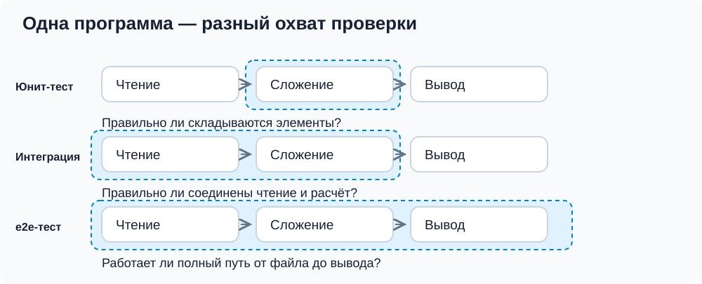
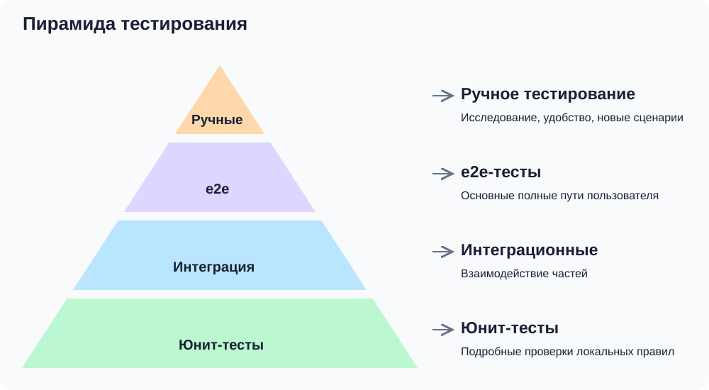
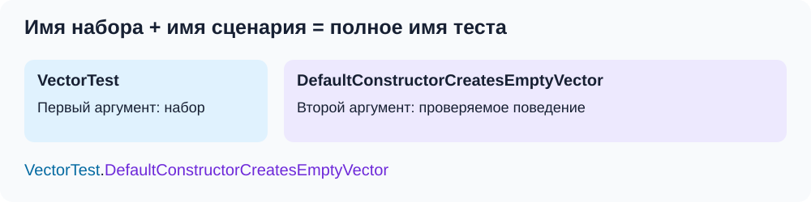

# От ручной проверки к тесту

Успешная компиляция ещё не означает, что программа работает правильно. Она может запускаться, но неверно вычислять результат или обрабатывать ввод. Как проверить её поведение и заметить ошибку после следующей правки?

## Зачем нужны тесты

Допустим, программа рассчитывает стоимость заказа со скидкой. Проверить один заказ вручную легко. Но нужны и другие случаи: без скидки, с нулевой суммой, с недопустимыми данными. После изменения расчёта придётся повторить их все.

**Тест** — проверка поведения в определённой ситуации: есть исходные условия, действие и ожидаемый результат. Ожидание формулируем по требованиям. Например, при сумме 1000 и скидке 10% итог должен быть 900.


Сохранённые проверки помогают обнаруживать ошибки и решают ещё три задачи:

- **Защита от регрессий.** Регрессия — поломка ранее работавшего поведения после изменения. Добавили новую скидку, а заказ без скидки стал рассчитываться неверно — тест помогает это заметить.
- **Поддержка рефакторинга.** Можно менять устройство кода и проверять, что его поведение сохранилось.
- **Примеры контракта.** Тест фиксирует конкретное обещание программы и позволяет выполнить проверку этого обещания.

Тесты тоже могут ошибаться. Неверное ожидание будет защищать неверное поведение; при изменении требований его нужно пересмотреть. Зелёный набор означает, что выбранные случаи прошли выбранные проверки, а не что ошибок больше нет.

## Ручное и автоматизированное тестирование

При **ручном тестировании** человек выполняет действия и оценивает результат: вводит сумму и скидку, сверяет итог. Сценарий можно записать заранее, чтобы повторять проверку.

При **исследовательском тестировании** новые проверки придумывают по ходу изучения программы: что будет, если оставить поле пустым, ввести текст вместо числа или изменить скидку после расчёта? Человек также оценивает понятность сообщений и удобство интерфейса.

При **автоматизированном тестировании** действия и проверки записаны в коде. Программа сама повторяет сценарии и сообщает о несовпадениях. Это удобно для известных проверок, которые нужны после каждой правки; входы и ожидания по-прежнему выбирает человек.

Способ выполнения и уровень теста — разные признаки. Полный пользовательский сценарий можно проверить вручную или автоматизировать.

## Назначение юнит-тестов

**Юнит-тест**, или модульный тест, проверяет небольшую часть программы с контролируемыми входами. Например, функцию расчёта заказа можно проверить без запуска всего приложения. В этом занятии используем знакомый `Vector`: создание, копирование, присваивание и сложение.

«Юнит» не обязательно означает один метод. Для проверки независимости копии мы создаём объект, копируем его, изменяем элемент и читаем оригинал. Несколько методов участвуют в одном сценарии поведения класса.

Такие тесты помогают быстро находить ошибки локальной логики. Наши проверки создают собственные объекты и не зависят от сети, пользовательского ввода и результатов других тестов. Использование стандартной библиотеки этому не мешает: важно контролировать зависимости, способные менять результат.

**Юнит-тесты должны быть быстрыми**, чтобы их можно было запускать после небольших правок и сразу связывать ошибку с причиной. Важен весь набор: тысяча тестов по секунде при последовательном выполнении занимает около 17 минут. Для маленькой операции `Vector` достаточно нескольких объектов и сравнений; ненужные задержки, огромные входы и внешние процессы мешают быстрой обратной связи.

Проверка `operator+` не подтверждает правильность чтения файлов или запуска приложения. Для этого нужны другие уровни.

## Уровни тестирования

Представим условное приложение: `Vector` отвечает за сложение, другие модули — за чтение двух векторов из файла и вывод. Этот мысленный пример нужен для сравнения уровней; в проекте занятия реализованы только юнит-тесты класса.



Синий контур показывает область проверки:

- **Юнит-тест** проверяет локальное поведение — например, поэлементное сложение.
- **Интеграционный тест** проверяет взаимодействие частей: текст `"3 -4"` проходит через настоящий модуль чтения, полученный `Vector` используется в расчёте. Он может заметить потерю знака или ошибку формата на границе модулей. Внешний сервер для интеграционного теста не обязателен.
- **e2e-тест** (*end-to-end*) проходит полный путь: подготовить файл, запустить приложение, получить результат. Он проверяет, что части соединены в работающий пользовательский сценарий.

**Системный тест** проверяет собранную программу через внешний интерфейс: аргументы запуска, код завершения, вывод. Для небольшой консольной программы системный и e2e-тест могут совпасть; в большой системе e2e-путь может проходить через несколько приложений.

## Пирамида тестов

Проверять каждую мелочь через всю программу обычно дорого, а одних проверок классов недостаточно для уверенности в их взаимодействии. **Пирамида тестов** предлагает много небольших проверок в основании и меньше полных сценариев наверху.



В нашей расширенной схеме над автоматизированными e2e-тестами находится ручное исследование программы с позиции пользователя. Классическая [пирамида автоматизированных тестов](https://martinfowler.com/bliki/TestPyramid.html) описывает автоматизированные уровни; здесь добавлена роль человека. Ручное выполнение возможно и для более узких проверок.

Охват обычно влияет на стоимость выполнения:

- **Юнит-тесты:** короткие операции в памяти, удобны для частого запуска.
- **Интеграционные:** время зависит от соединяемых частей и подготовки файлов, базы данных или процессов.
- **e2e:** запуск приложения и полный путь обычно требуют больше времени и окружения.
- **Ручные:** требуют времени человека на действия, наблюдение и оценку удобства; помогают находить новые случаи. Воспроизводимую ошибку полезно закрепить автоматическим тестом. См. [The Practical Test Pyramid](https://martinfowler.com/articles/practical-test-pyramid.html#ExploratoryTesting).

Это тенденция, а не строгая шкала: маленький интеграционный тест может быть быстрее плохо организованного юнит-теста. Ширина слоя не означает важность и не задаёт обязательные проценты. Состав набора выбираем по рискам и устройству программы.

Для условного приложения подробно проверим случаи сложения на уровне `Vector`, формат и передачу данных — на уровне интеграции, а основные полные пути — через e2e. Повторять все комбинации чисел на каждом уровне не требуется.

## Первый тест с Google Test

Google Test, или gtest, организует запуск и сообщает о несовпадениях. Уровень определяется охватом проверки, а не библиотекой: здесь начнём с юнит-теста `Vector`.

Пустой вектор должен сообщать размер ноль:

```cpp
#include "vector.h"
#include <gtest/gtest.h>

TEST(VectorTest, DefaultConstructorCreatesEmptyVector) {
    Vector values;
    EXPECT_EQ(values.size(), 0);
}
```

В теле создаётся `Vector`, затем `EXPECT_EQ(values.size(), 0)` сравнивает его размер с нулём. При несовпадении Google Test отмечает сценарий как неуспешный и показывает полученные значения.

`TEST` — макрос, создающий служебный код объявления и регистрации теста. Его аргументы задают имя набора и имя сценария:



**Первый аргумент, `VectorTest`, — группа проверяемого поведения** (*test suite*). Для обычного `TEST` отдельный класс `VectorTest` объявлять не нужно. **Второй, `DefaultConstructorCreatesEmptyVector`, — конкретное ожидание:** конструктор по умолчанию создаёт пустой вектор. Имя `Test1` не помогло бы понять причину падения.

Передаём идентификаторы C++ без кавычек, а не объекты или входные данные. Входы создаются в теле. Имена сценариев внутри одного набора уникальны; одинаковые имена в разных наборах допустимы. Используем понятные имена без пробелов и подчёркиваний.

Полное имя — `VectorTest.DefaultConstructorCreatesEmptyVector`. Оно объединяет связанные проверки в отчёте, обозначает упавший сценарий и позволяет выбрать его для запуска. Общий набор не задаёт порядок и не создаёт общий объект между тестами. У `TEST_F` и `TEST_P` первый аргумент будет именем объявленной фикстуры — разберём это в третьей части. Синтаксис описан в [GoogleTest Primer](https://google.github.io/googletest/primer.html).

## Собрать и запустить первый тест

Тесты — отдельная программа `vector_tests`. Её `main` предоставляет библиотека `GTest::gtest_main`; наш код с `TEST` находится на уровне файла. Полный [CMakeLists.txt](../practice/CMakeLists.txt) и [пример](../practice/README.md) уже готовы.

Из корня репозитория:

```bash
cmake -S lessons/05-unit-tests/practice -B /tmp/cpp-unit-tests -DCMAKE_BUILD_TYPE=Debug
cmake --build /tmp/cpp-unit-tests --config Debug
ctest --test-dir /tmp/cpp-unit-tests -C Debug -R '^VectorTest.DefaultConstructorCreatesEmptyVector$' --output-on-failure
```

Команды подготавливают сборку, компилируют программу и запускают один тест. `-R` — фильтр имён CTest; здесь он совпадает с полным именем сценария. Для первого скачивания Google Test нужен GitHub; использование локальных исходников описано в README проекта.

При успехе CTest сообщает, что один тест прошёл; при несовпадении показывает ошибку. Успешная сборка и успешная проверка — разные результаты. Теперь разберём устройство проверок; подробности сборки и запуск набора находятся в третьей части.

## Подготовка, действие и проверка

Три шага теста называют **Arrange** — подготовка, **Act** — действие, **Assert** — проверка результата:

```cpp
TEST(VectorTest, ElementCanBeChanged) {
    Vector values(2);        // Arrange
    ASSERT_EQ(values.size(), 2);

    values[1] = 42;          // Act

    EXPECT_EQ(values[1], 42); // Assert
    EXPECT_EQ(values[0], 0);
}
```

Размер проверяем до индексирования. Нулевая инициализация — обещание нашего класса, а не общее свойство всех контейнеров.

## EXPECT и ASSERT

`EXPECT_*` при несовпадении отмечает тест как неуспешный и продолжает текущую функцию. `ASSERT_*` также фиксирует ошибку, но завершает текущую функцию. Остальные тесты могут выполняться дальше.

Поэтому перед индексированием используем `ASSERT_EQ`: без нужного размера продолжать небезопасно. Независимые значения проверяем через `EXPECT_EQ`, чтобы увидеть несколько ошибок за запуск. Если `ASSERT` стоит во вспомогательной функции, завершится только она; вызывающий тест может продолжить работу.

Локальные объекты при раннем выходе уничтожаются: `Vector` освободит массив. Но ручной `delete`, записанный после неуспешного `ASSERT`, не выполнится — в тестах тоже нужен RAII.

## Как прочитать падение

Если `size()` вернул единицу вместо нуля, сообщение будет примерно таким:

```text
Expected equality of these values:
  values.size()
    Which is: 1
  0
```

Рядом будут файл, строка и имя сценария. Проверяем ожидание, подготовку данных и реализацию: ошибка может быть и в тесте. Более поздняя успешная проверка не отменит уже зарегистрированную ошибку.

В цикле полезно добавить контекст через `<<`:

```cpp
TEST(VectorTest, NewElementsAreZero) {
    Vector values(3);
    ASSERT_EQ(values.size(), 3);
    for (int i = 0; i < values.size(); ++i) {
        EXPECT_EQ(values[i], 0) << "element index = " << i;
    }
}
```

## Вопросы для самопроверки

**Зачем нужны юнит-тесты, если есть полный запуск?** Чтобы подробно и быстро проверять локальные правила и точнее находить причину ошибки. Полный путь проверяет соединение частей.

**Почему юнит-тесты должны быть быстрыми?** Чтобы часто запускать набор и получать результат сразу после правки.

**Что передаём в TEST?** Имя набора и имя сценария без кавычек; данные создаём в теле.

**Когда нужен ASSERT?** Когда без выполненной предпосылки дальнейшие действия небезопасны или бессмысленны.

**Достаточно вызвать метод без проверок?** Так можно заметить сбой или неожиданное исключение, но нельзя подтвердить нужный результат.

## Дополнительно: другие признаки классификации

Уровень отвечает на вопрос «какую часть программы проверяем?». Есть и другие признаки:

- **Функциональные проверки:** правильно ли выполняется требуемое действие, например расчёт суммы.
- **Нефункциональные:** приемлемы ли скорость и устойчивость, например при обработке большого файла или нагрузке.
- **Приёмочные:** выполнены ли согласованные требования пользователя. Могут находиться на разных уровнях.
- **Регрессионные:** сохранилось ли прежнее поведение после изменений. Это назначение теста, а не отдельный уровень пирамиды.
- **Дымовые / smoke:** запускается ли программа и работает ли базовый сценарий; подробные проверки всё равно нужны.

## Дополнительно: сравнения значений

`EXPECT_EQ` и `EXPECT_NE` проверяют равенство и неравенство; `EXPECT_LT`, `EXPECT_LE`, `EXPECT_GT`, `EXPECT_GE` — порядок; `EXPECT_TRUE` и `EXPECT_FALSE` — условие. `EXPECT_EQ(values.size(), 2)` показывает несовпавшие значения подробнее, чем `EXPECT_TRUE(values.size() == 2)`.

Для `std::string` равенство сравнивает содержимое, для указателей — адреса. C-строки сравниваем через `EXPECT_STREQ`. Для дробных вычислений можно задать абсолютную погрешность через `EXPECT_NEAR`:

```cpp
TEST(AssertionsTest, ComparesStringsAndFloatingPoint) {
    const char first[] = "vector";
    const char second[] = "vector";
    EXPECT_STREQ(first, second);
    EXPECT_NEAR(0.1 + 0.2, 0.3, 1e-12);
}
```

Допуск выбираем по смыслу вычисления: слишком широкий скроет ошибку. У нашего `Vector` элементы целые. Подробности — в [Assertions Reference](https://google.github.io/googletest/reference/assertions.html).

Действия с побочными эффектами лучше выполнять до проверки: так проще читать тест и не зависеть от порядка вычисления аргументов.
