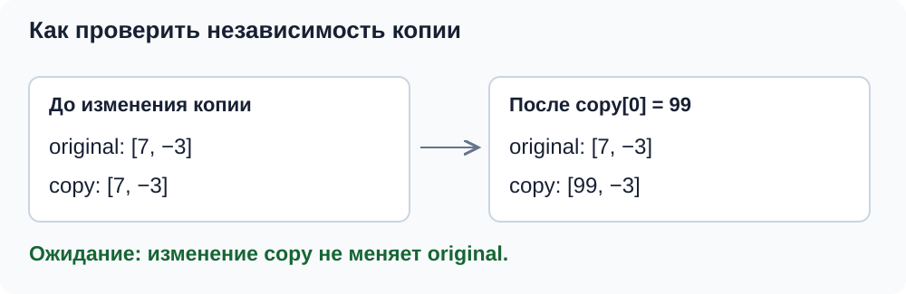

# Как выбрать полезные проверки

Начнём с обещаний класса. Наш `Vector` хранит целые числа; новый массив заполнен нулями, копия независима от оригинала, присваивание заменяет прежнее содержимое. Сложение выполняется поэлементно для одинаковых размеров. Отрицательный размер и сложение разных размеров приводят к `std::length_error`.

Используем контракт из [занятия 2](../../02-classes-and-vector/README.md).

## От обещания класса к набору проверок

Чтобы придумать тест, начнём с конкретного обещания и пройдём четыре шага:

1. **Выбрать поведение.** Например, конструктор сохраняет заданный размер.
2. **Выбрать случаи.** Обычный — несколько элементов, граничные — ноль и один, ошибочный — отрицательный размер.
3. **Записать ожидаемый результат.** Для допустимого размера `size()` возвращает переданное число; для отрицательного — конструктор выбрасывает `std::length_error`.
4. **Проверить наблюдаемое поведение.** Создать объект и обратиться к его публичному интерфейсу. Не нужно читать приватные поля или повторять алгоритм конструктора в тесте.

Для копирования обычный случай — непустой источник, граничный — пустой. Отдельное обещание — независимость копии: чтобы проверить его, изменим копию и прочитаем оригинал. Для сложения выберем одинаковые размеры, два пустых вектора и разные размеры.

Затем зададим вопрос: какую правдоподобную ошибку заметят наши ожидания? Проверка размера обнаружит неверную длину, но не забытое копирование элементов. Поэтому нужны ожидания о значениях и об изменениях состояния. Ниже применим этот способ к операциям `Vector`.

## Равный размер ещё не означает правильную копию

Рассмотрим слабую проверку присваивания. Внутри теста можно написать:

```cpp
Vector source(2);
Vector destination;
destination = source;
EXPECT_EQ(destination.size(), source.size());
```

Она проверяет длину, но ничего не говорит о содержимом и независимости объектов. Реализация могла выделить массив нужной длины, но забыть скопировать элементы — проверка осталась бы зелёной. Заполним источник различимыми значениями и проверим обещание независимой копии. Сначала рассмотрим копирующий конструктор, затем присваивание.



Нужны различимые значения и проверка независимости:

```cpp
TEST(VectorTest, CopyConstructorCreatesIndependentCopy) {
    Vector original(2);
    ASSERT_EQ(original.size(), 2);
    original[0] = 7;
    original[1] = -3;

    Vector copy(original);

    ASSERT_EQ(copy.size(), 2);
    EXPECT_EQ(copy[0], 7);
    EXPECT_EQ(copy[1], -3);
    copy[0] = 99;
    EXPECT_EQ(original[0], 7);
}
```

Первые ожидания обнаружат потерю данных. Последнее выявит разделение одного массива между двумя объектами: изменение копии не должно менять оригинал. Так тест проверяет наблюдаемое поведение, не открывая приватное поле `arr_`.

Копирующий конструктор создаёт новый объект. Оператор присваивания работает с уже существующим, у которого есть прежние данные. Это разные пути, поэтому нужен отдельный сценарий:

```cpp
TEST(VectorTest, AssignmentReplacesContentsAndReturnsDestination) {
    Vector source(2);
    ASSERT_EQ(source.size(), 2);
    source[0] = 7;
    source[1] = -3;
    Vector destination(1);
    ASSERT_EQ(destination.size(), 1);
    destination[0] = 100;

    Vector& returned = (destination = source);

    EXPECT_EQ(&returned, &destination);
    ASSERT_EQ(destination.size(), 2);
    EXPECT_EQ(destination[0], 7);
    EXPECT_EQ(destination[1], -3);
    destination[0] = 99;
    EXPECT_EQ(source[0], 7);
}
```

Здесь разные исходные размеры делают замену заметной. Проверка адресов осмысленна: оператор должен вернуть ссылку именно на получателя.

Отдельные границы — присваивание пустого вектора непустому, копирование пустого вектора и самоприсваивание. Например:

```cpp
TEST(VectorTest, SelfAssignmentPreservesContents) {
    Vector values(1);
    ASSERT_EQ(values.size(), 1);
    values[0] = 7;
    Vector& alias = values;

    values = alias;

    ASSERT_EQ(values.size(), 1);
    EXPECT_EQ(values[0], 7);
}
```

Ссылка `alias` обозначает тот же объект. Такой сценарий показывает, почему удалять старый массив до обработки самоприсваивания опасно.

## Сложение: результат и исходные объекты

Используем небольшие числа, для которых ответ легко посчитать независимо от реализации:

```cpp
TEST(VectorTest, AdditionProducesSumWithoutChangingOperands) {
    Vector left(2);
    Vector right(2);
    ASSERT_EQ(left.size(), 2);
    ASSERT_EQ(right.size(), 2);
    left[0] = 3;
    left[1] = -4;
    right[0] = 5;
    right[1] = 4;

    Vector result = left + right;

    ASSERT_EQ(result.size(), 2);
    EXPECT_EQ(result[0], 8);
    EXPECT_EQ(result[1], 0);
    EXPECT_EQ(left[0], 3);
    EXPECT_EQ(left[1], -4);
    EXPECT_EQ(right[0], 5);
    EXPECT_EQ(right[1], 4);
    result[0] = 100;
    EXPECT_EQ(left[0], 3);
    EXPECT_EQ(right[0], 5);
}
```

Тест охватывает положительную сумму, взаимное сокращение, сохранение операндов и независимость результата. Не вычисляем ожидаемое значение вызовом того же `operator+`: иначе сравним реализацию с ней самой.

Все ожидания здесь относятся к одному сценарию сложения; отрицательный размер проверим отдельно.

## Ошибочный сценарий — тоже поведение

Для примеров ниже нужен `<stdexcept>`:

```cpp
TEST(VectorTest, AdditionRejectsDifferentSizes) {
    Vector left(1);
    Vector right(2);
    ASSERT_EQ(left.size(), 1);
    ASSERT_EQ(right.size(), 2);
    left[0] = 7;
    right[0] = 8;
    right[1] = 9;

    EXPECT_THROW(left + right, std::length_error);

    ASSERT_EQ(left.size(), 1);
    ASSERT_EQ(right.size(), 2);
    EXPECT_EQ(left[0], 7);
    EXPECT_EQ(right[0], 8);
    EXPECT_EQ(right[1], 9);
}

TEST(VectorTest, ConstructorRejectsNegativeSize) {
    EXPECT_THROW(Vector(-1), std::length_error);
}
```

`EXPECT_THROW` проверяет выбрасывание указанного типа исключения; текст сообщения он не проверяет. Без исключения или с неподходящим типом проверка падает. `EXPECT_ANY_THROW` подходит, если контракт допускает любое исключение, а `EXPECT_NO_THROW` — если исключения быть не должно. Эти варианты описаны в [справочнике проверок исключений](https://google.github.io/googletest/reference/assertions.html#exception-assertions).

Проверки после ошибочного сложения подтверждают сохранение данных операндов. Однако они не проверяют все гарантии при нехватке памяти: для этого нужен способ управляемо вызвать сбой выделения. Обычный успешный запуск присваивания не доказывает его безопасность при `std::bad_alloc`.

## const: что проверяется во время сборки

```cpp
TEST(VectorTest, ConstReferenceAllowsReading) {
    Vector values(1);
    ASSERT_EQ(values.size(), 1);
    values[0] = 42;
    const Vector& readonly = values;

    EXPECT_EQ(readonly[0], 42);
}
```

Само выражение `readonly[0]` использует константную перегрузку. Запрет записи — свойство типов, которое проверяет компилятор. Строка `readonly[0] = 10;` не должна компилироваться, поэтому её нельзя помещать в обычный запускаемый тест как «ожидаемое падение». Для проверки возвращаемого типа можно использовать `static_assert`. Это дополнительный материал в конце `practice/test.cpp`: он не нужен для первых тестов Google Test.

## Границы и пределы проверок

Выбранные в начале граничные случаи полезны, потому что могут выполнять другой путь в коде. Например, при размере ноль не выделяется массив и не выполняется проход цикла.

У нашего `operator[]` нет проверки границ. Обращение к `values[values.size()]` нарушает его предусловие и ведёт к неопределённому поведению. Нельзя написать `EXPECT_THROW` и ожидать корректного исключения. Аналогично переполнение знакового `int` при сложении не имеет обещанного результата. В обычных тестах выбираем данные в допустимых границах; для обнаружения ошибок памяти полезны санитайзеры.

Покрытие строк показывает, какой код исполнялся, но не насколько сильны ожидания. Силу ожиданий можно оценить, временно внеся правдоподобную ошибку: забытое копирование, неправильный индекс или изменение исходного объекта. Если тест её не замечает, стоит пересмотреть данные и проверки.

## Вопросы для самопроверки

**Почему проверка только размера не проверяет присваивание полностью?** Массив может иметь нужный размер и неверные элементы; кроме того, источник и получатель могут ошибочно разделять память.

**Нужно ли тестировать приватный указатель?** Здесь достаточно изменения копии и чтения оригинала. Тест остаётся пригодным при смене внутреннего представления.

**Почему не проверяем выход за границы через EXPECT_THROW?** Контракт текущей реализации не обещает исключение; нарушение предусловия вызывает неопределённое поведение.
