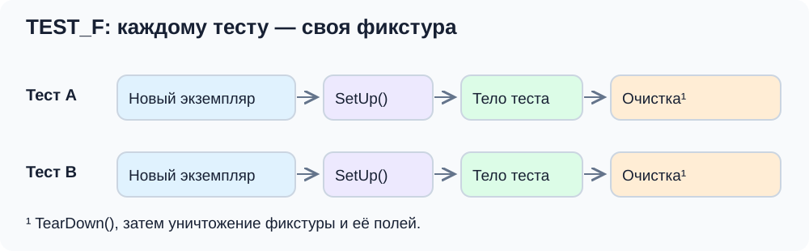
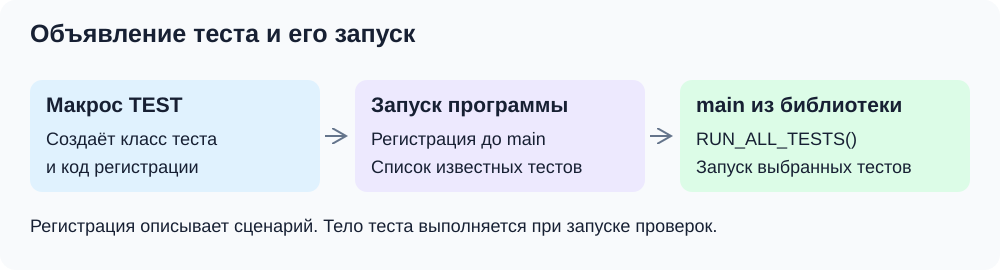
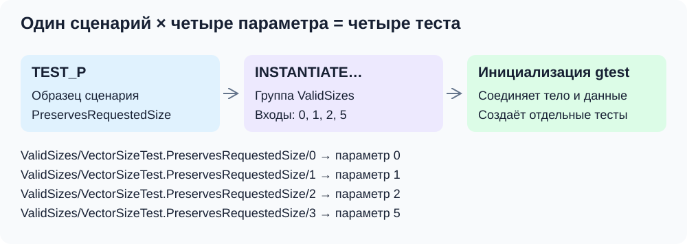

# Повторное использование и запуск

Когда несколько тестов начинают с одинаковых данных, копирование подготовки затрудняет чтение. Google Test позволяет вынести её в **фикстуру** — класс, который хранит исходные объекты и готовит их перед тестом.

## Фикстура: общий рецепт, отдельные объекты

У `TEST_F(PreparedVectorTest, ReadsPreparedValues)` первый аргумент — **имя объявленного класса фикстуры** `PreparedVectorTest`. Оно одновременно становится именем набора. Второй — **имя сценария** `ReadsPreparedValues`, как у обычного `TEST`. Полное имя будет `PreparedVectorTest.ReadsPreparedValues`.

Здесь первый аргумент определяет не только группировку: от него зависит, какие поля и подготовка доступны тесту. Поэтому класс фикстуры объявляем до макроса. Передаём имя класса без кавычек, а не объект этого класса и не имя тестируемого `Vector`.

```cpp
class PreparedVectorTest : public ::testing::Test {
protected:
    Vector values{2};

    void SetUp() override {
        ASSERT_EQ(values.size(), 2);
        values[0] = 7;
        values[1] = -3;
    }
};

TEST_F(PreparedVectorTest, ReadsPreparedValues) {
    EXPECT_EQ(values[0], 7);
    EXPECT_EQ(values[1], -3);
}

TEST_F(PreparedVectorTest, CanChangeFirstElement) {
    values[0] = 99;
    EXPECT_EQ(values[0], 99);
    EXPECT_EQ(values[1], -3);
}
```

В записи `class PreparedVectorTest : public ::testing::Test` наш класс наследует готовый класс библиотеки. Для этого занятия достаточно понимать, что библиотека вызывает предусмотренные ею методы жизненного цикла. `protected` делает поле доступным коду тестов, создаваемому макросом. `override` просит компилятор проверить, что `SetUp` действительно переопределяет метод базового класса; это помогает обнаружить опечатку в имени.

Перед каждым тестом создаётся новый её экземпляр и вызывается `SetUp`; после тела — `TearDown`, затем объект уничтожается. Поэтому изменение `values` во втором тесте не влияет на первый. При fatal-проверке в `SetUp` тело теста пропускается, а очистка выполняется. См. [описание жизненного цикла](https://google.github.io/googletest/primer.html#test-fixtures-using-the-same-data-configuration-for-multiple-tests).



В нашем примере `TearDown` не нужен: массив освободит деструктор поля `values`. Он пригодится для явной очистки внешнего состояния. Простую инициализацию можно делать конструктором; `SetUp` удобен, когда подготовке нужны проверки Google Test.

Фикстура не должна скрывать смысл сценария. Если тесту нужен особый набор данных, часто яснее создать его в самом тесте. Не нужно заводить общий изменяемый глобальный вектор: тогда результат начнёт зависеть от порядка запусков.

## Один сценарий, несколько входов

У конструктора один общий вопрос: сохраняет ли он переданный допустимый размер? Чтобы не писать четыре одинаковых теста, отделим сценарий от данных.

У `TEST_P(VectorSizeTest, PreservesRequestedSize)` первый аргумент — **имя параметризованной фикстуры** `VectorSizeTest`, второй — **имя сценария** `PreservesRequestedSize`. Числа `0`, `1`, `2`, `5` не являются аргументами `TEST_P`: их задаём отдельно через `INSTANTIATE_TEST_SUITE_P`. Внутри сценария текущий вход получаем через `GetParam()`.

Объявим фикстуру, сценарий и группу значений:

```cpp
class VectorSizeTest : public ::testing::TestWithParam<int> {};

TEST_P(VectorSizeTest, PreservesRequestedSize) {
    const int requestedSize = GetParam();
    Vector values(requestedSize);
    EXPECT_EQ(values.size(), requestedSize);
}

INSTANTIATE_TEST_SUITE_P(
    ValidSizes,
    VectorSizeTest,
    ::testing::Values(0, 1, 2, 5)
);
```

`TestWithParam<int>` — готовый класс для параметра типа `int`. `TEST_P` задаёт тело, `GetParam()` получает вход текущего запуска, а `INSTANTIATE_TEST_SUITE_P` создаёт конкретные тесты из списка. Полное имя первого запуска будет `ValidSizes/VectorSizeTest.PreservesRequestedSize/0`. Оно складывается из префикса `INSTANTIATE_TEST_SUITE_P`, двух имён из `TEST_P` и суффикса параметра. По этой записи можно определить и сценарий, и конкретный вариант его запуска.

В `INSTANTIATE_TEST_SUITE_P` передаём:

- `ValidSizes` — префикс группы запусков;
- `VectorSizeTest` — имя объявленной параметризованной фикстуры;
- `::testing::Values(0, 1, 2, 5)` — генератор входов, то есть последовательность значений для отдельных запусков. `Values` — функция библиотеки, а не макрос объявления теста.

Эта запись даёт четыре теста. Суффикс — индекс: вход `5` получает `/3`, а не `/5`. Для двух `TEST_P` той же фикстуры и четырёх входов будет восемь тестов.

Можно было бы передавать пару «вход, ожидаемый размер»: `(0, 0)`, `(1, 1)`, `(2, 2)`. Но в этом сценарии оба числа всегда равны, поэтому достаточно одного параметра. Когда входов несколько и ожидаемый ответ отличается от них, полезен именованный тип:

```cpp
struct AdditionCase {
    int left;
    int right;
    int expected;
};

class VectorAdditionTest
    : public ::testing::TestWithParam<AdditionCase> {};

TEST_P(VectorAdditionTest, AddsSingleElements) {
    const AdditionCase input = GetParam();
    Vector left(1);
    Vector right(1);
    ASSERT_EQ(left.size(), 1);
    ASSERT_EQ(right.size(), 1);
    left[0] = input.left;
    right[0] = input.right;

    Vector result = left + right;

    ASSERT_EQ(result.size(), 1);
    EXPECT_EQ(result[0], input.expected)
        << "left = " << input.left << ", right = " << input.right;
}

INSTANTIATE_TEST_SUITE_P(
    SignedValues,
    VectorAdditionTest,
    ::testing::Values(
        AdditionCase{3, 5, 8},
        AdditionCase{-4, 4, 0},
        AdditionCase{-2, -3, -5}
    )
);
```

Ожидаемые ответы записаны независимо от реализации. Параметры полезны для одинаковой логики проверки. Если меняются и действия, и ожидания, отдельные именованные тесты обычно проще. Синтаксис описан в [Testing Reference](https://google.github.io/googletest/reference/testing.html#TEST_P).

## Из чего состоит тестовая программа

В первой части мы запускали один тест. Теперь разберём сборку программы `vector_tests`: реализация класса, файл проверок и Google Test должны связаться в одну исполняемую цель.

Библиотека `vector` содержит класс, `GTest::gtest` — механизм проверок и запуска. `GTest::gtest_main` добавляет отдельный `main`: он вызывает `InitGoogleTest` и `RUN_ALL_TESTS()`. Его реальный исходник — [`gtest_main.cc`](https://github.com/google/googletest/blob/58d77fa8070e8cec2dc1ed015d66b454c8d78850/googletest/src/gtest_main.cc). Макросы объявляют и регистрируют сценарии; `main` запускает их.

### Что добавить в CMakeLists.txt

Полный запускаемый пример находится в [practice/CMakeLists.txt](../practice/CMakeLists.txt), а команды сборки — в [README проекта](../practice/README.md). `VECTOR_SOURCE_DIR` указывает на существующие исходники из занятия 2; в собственном проекте здесь будет папка вашей библиотеки.

Для уже подключённой библиотеки и Google Test ключевые строки такие:

```cmake
add_executable(vector_tests test.cpp)
target_link_libraries(vector_tests PRIVATE vector GTest::gtest_main)
include(GoogleTest)
gtest_discover_tests(vector_tests)
```

`add_library` собирает реализацию `Vector`, `target_include_directories` задаёт путь к заголовку, `target_compile_features` — C++20. `PUBLIC` передаёт путь и стандарт использующей библиотеку цели тестов. Уже описанную в CMake библиотеку повторно создавать не нужно.

`include(CTest)` подключает запуск через CTest и создаёт опцию `BUILD_TESTING`, включённую по умолчанию. Блок `if(BUILD_TESTING)` позволяет отключить зависимость и цели тестов при конфигурировании с `-DBUILD_TESTING=OFF`. Проверки при этом не собираются и не регистрируются; тестируемая библиотека остаётся.

`FetchContent_Declare` описывает, откуда получить Google Test, а `FetchContent_MakeAvailable` подключает его исходники и CMake-цели. Мы закрепили конкретную ревизию, чтобы воспроизводить сборку. Схема получения зависимости показана в [CMake Quickstart](https://google.github.io/googletest/quickstart-cmake.html).

`add_executable` создаёт программу из `test.cpp`, `target_link_libraries` связывает её с `vector` и Google Test с готовым `main`. Цели Google Test передают пути к своим заголовкам автоматически.

Обычный `main.cpp` приложения остаётся в его собственной цели. В `vector_tests` добавляем файлы проверок и библиотеку, которую тестируем.

### Как тесты становятся известны CTest

`include(GoogleTest)` подключает CMake-модуль с командой `gtest_discover_tests`. В нашей конфигурации после сборки он запускает `vector_tests --gtest_list_tests`, получает имена из реестра Google Test и создаёт записи для CTest. Тела сценариев при получении списка не выполняются.

Здесь две регистрации на разных уровнях: макросы регистрируют сценарии **внутри программы Google Test**, а `gtest_discover_tests` делает эти сценарии доступными **снаружи через CTest**. Без последней команды программу можно запускать напрямую, но CTest не узнает о её сценариях через этот механизм. См. [документацию модуля GoogleTest для CMake](https://cmake.org/cmake/help/latest/module/GoogleTest.html).

## Запуск и поиск причины падения

Из корня репозитория:

```bash
cmake -S lessons/05-unit-tests/practice -B /tmp/cpp-unit-tests -DCMAKE_BUILD_TYPE=Debug
cmake --build /tmp/cpp-unit-tests
ctest --test-dir /tmp/cpp-unit-tests --output-on-failure
```

Полное имя из аргументов макроса позволяет выбрать один сценарий или весь набор. Например, `--gtest_filter='VectorTest.DefaultConstructorCreatesEmptyVector'` запускает один тест, а `--gtest_filter='VectorTest.*'` — весь набор. При переименовании теста настроенные фильтры тоже нужно обновить.

Посмотреть зарегистрированные тесты можно через `ctest --test-dir /tmp/cpp-unit-tests -N`. Для запуска самой программы и её фильтра:

```bash
/tmp/cpp-unit-tests/vector_tests --gtest_list_tests
/tmp/cpp-unit-tests/vector_tests --gtest_filter='VectorTest.*'
/tmp/cpp-unit-tests/vector_tests --gtest_filter='ValidSizes/*'
/tmp/cpp-unit-tests/vector_tests --gtest_shuffle --gtest_repeat=20
```

`*` в фильтре соответствует последовательности символов; кавычки защищают его от раскрытия оболочкой. Последняя команда меняет порядок и повторяет набор. Она помогает обнаружить зависимость от общего состояния; устойчивый запуск не доказывает отсутствие такой зависимости. Для повторения конкретного перемешанного порядка можно передать показанный seed через `--gtest_random_seed`. Флаги описаны в [Advanced Topics](https://google.github.io/googletest/advanced.html#running-test-programs-advanced-options).

Если ошибка возникает в одном сценарии, запускаем его отдельно и смотрим первое нарушенное ожидание. Если только после другого теста — ищем общее состояние. Если программа аварийно завершается без полезного сообщения проверки — пригодятся отладчик и санитайзеры.

Имя с префиксом `DISABLED_` отключает тест при обычном запуске. Это не исправление: отключённый сценарий не проверяет поведение и не должен считаться успешным.

## Вопросы для самопроверки

**Разделяют ли TEST_F один объект?** Нет: рецепт подготовки общий, экземпляр для каждого теста отдельный.

**Чем отличаются аргументы TEST и TEST_F?** У `TEST` первый аргумент задаёт имя группы. У `TEST_F` он также выбирает объявленный класс фикстуры. Второй аргумент в обоих случаях — имя сценария.

**Что связывают TEST_P и INSTANTIATE_TEST_SUITE_P?** Первый задаёт сценарий, второй — группу входов для его фикстуры. Каждое значение даёт отдельный запуск.

**Зачем gtest_discover_tests?** Сделать зарегистрированные в Google Test сценарии известными CTest.

## Дополнительно: что создают макросы под капотом

До сих пор мы использовали короткую запись, похожую на вызов функции. Но `TEST`, `TEST_F` и `TEST_P` — **макросы препроцессора**. До компиляции они разворачиваются в объявления классов, методы и код регистрации. Само тело теста остаётся обычным C++ и выполняется позже, при запуске программы.

### TEST: класс и регистрация сценария

Для записи `TEST(VectorTest, DefaultConstructorCreatesEmptyVector)` Google Test создаёт отдельный класс, наследующий `testing::Test`. Наши строки внутри фигурных скобок становятся телом его метода `TestBody`. По смыслу получается такой код; это упрощение, а не полный результат раскрытия макроса:

```cpp
class VectorTest_DefaultConstructorCreatesEmptyVector_Test
    : public ::testing::Test {
private:
    void TestBody() override {
        Vector values;
        EXPECT_EQ(values.size(), 0);
    }
};
```

Одного класса недостаточно: библиотека должна узнать, что его нужно запустить. Макрос также создаёт статическое поле с инициализатором, который регистрирует описание сценария. При запуске программы, до входа в `main`, в реестр попадают имя набора, имя теста, файл, строка и способ создать объект этого класса. **Реестр** — внутренний список известных тестов, а **фабрика** в данном случае — объект библиотеки, который умеет создавать экземпляры нужного тестового класса.



Поэтому в `main` не нужно вручную перечислять вызовы тестов. `InitGoogleTest` обрабатывает параметры запуска, а `RUN_ALL_TESTS()` выбирает подходящие записи реестра, создаёт объекты тестов и выполняет их жизненный цикл. Регистрация описывает тест; она не выполняет действие `Vector values` из его тела.

### TEST_F: тот же механизм с нашей фикстурой

`TEST_F(PreparedVectorTest, ReadsPreparedValues)` создаёт класс, наследующий **`PreparedVectorTest`**, а не непосредственно `testing::Test`. Благодаря этому тело теста получает доступ к полю `values` и другим доступным членам фикстуры. Созданный класс получает поля и подготовку фикстуры; библиотека запускает уже разобранный жизненный цикл для каждого отдельного объекта.

Общий экземпляр фикстуры между тестами не появляется. Глобальные переменные и внешние файлы Google Test автоматически не сбрасывает.

### TEST_P и INSTANTIATE_TEST_SUITE_P: сценарий и данные соединяются позже

У параметризованных тестов регистрация разделена на две части. `TEST_P` создаёт класс теста и регистрирует **образец сценария**, ещё без конкретного значения. `INSTANTIATE_TEST_SUITE_P` регистрирует группу входных данных для указанной фикстуры. Он не копирует тело теста в исходном файле и не является циклом, который выполняется в месте объявления.

Помимо трёх разобранных аргументов `INSTANTIATE_TEST_SUITE_P` принимает необязательную функцию формирования суффиксов имён. В нашем проекте достаточно индексов по умолчанию.

Во время инициализации Google Test соединяет зарегистрированные образцы с генераторами. Для каждой пары «сценарий + значение» появляется отдельная запись в реестре. При её запуске создаётся новый объект фикстуры, библиотека устанавливает текущий параметр, а `GetParam()` возвращает его внутри теста.



Если объявить `TEST_P`, но не задать значения через `INSTANTIATE_TEST_SUITE_P`, полезные запуски не появятся; наша версия Google Test сообщает о такой пропущенной инстанциации диагностическим тестом.

Макросы пишутся на уровне файла: `TEST_P` задаёт поведение, `INSTANTIATE_TEST_SUITE_P` — его варианты на заданных входах. Формы вызова приведены в [Testing Reference](https://google.github.io/googletest/reference/testing.html#INSTANTIATE_TEST_SUITE_P).

Внутренний механизм сверяется с закреплённой в проекте ревизией: [`GTEST_TEST_`](https://github.com/google/googletest/blob/58d77fa8070e8cec2dc1ed015d66b454c8d78850/googletest/include/gtest/internal/gtest-internal.h) создаёт класс и регистрацию, [`TEST_P` и `INSTANTIATE_TEST_SUITE_P`](https://github.com/google/googletest/blob/58d77fa8070e8cec2dc1ed015d66b454c8d78850/googletest/include/gtest/gtest-param-test.h) регистрируют образцы и генераторы. Пользоваться этими внутренними средствами напрямую для написания тестов не требуется.

### Когда нужен собственный main

Готового `GTest::gtest_main` достаточно для наших примеров. Если программе тестов нужна своя инициализация, можно связаться с `GTest::gtest` и написать собственный `main`:

```cpp
#include <gtest/gtest.h>

int main(int argc, char** argv) {
    ::testing::InitGoogleTest(&argc, argv);
    return RUN_ALL_TESTS();
}
```

Это альтернативная точка входа. Для неё заменяем `GTest::gtest_main` на `GTest::gtest` и добавляем файл с `main` в цель тестов. В текущем демонстрационном проекте оставляем готовую точку входа.

### Дополнительные настройки CMake

`DOWNLOAD_EXTRACT_TIMESTAMP TRUE` задаёт обновлённые временные метки распакованных файлов. `gtest_force_shared_crt` согласует использование динамической библиотеки среды выполнения на Windows/MSVC; на macOS/Linux эта настройка для нашего примера не требуется. Основная конфигурация целиком находится в `practice/CMakeLists.txt`.

**Откуда библиотека знает о TEST?** Код регистрации, созданный макросом, добавляет сценарий в реестр до `main`.

**Нужен ли свой main?** Для этого проекта достаточно `GTest::gtest_main`; собственную точку входа связывают с `GTest::gtest`.
