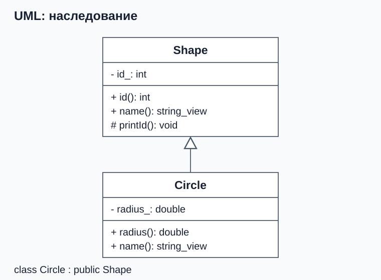
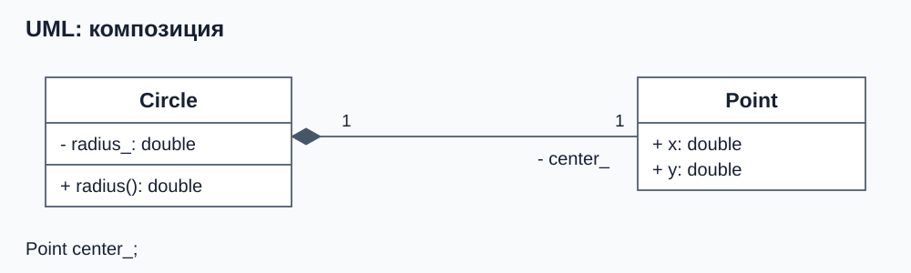

# От отношений между объектами к наследованию

Программа хранит круги и прямоугольники. У каждой фигуры есть идентификатор, но данные о размерах различаются: кругу нужен радиус, прямоугольнику — ширина и высота. Хотелось бы передавать любую фигуру в общий код и получать поведение именно этой фигуры.

## «Является» и «содержит»

Круг **является фигурой**: его можно передать туда, где ожидается фигура. Это отношение называют **is-a** и выражают публичным наследованием. Подстановка должна сохранять обещания базового интерфейса: например, конкретная фигура должна возвращать неотрицательную площадь для допустимых размеров. Это **принцип подстановки Лисков**; похожих названий и полей для него недостаточно.



Это **UML-диаграмма классов** — стандартная запись типов и связей. Прямоугольник обозначает класс; отделения содержат его имя, поля и операции. Запись `radius_: double` задаёт имя и тип поля, `radius(): double` — операцию и тип результата. Знаки `+`, `-` и `#` обозначают соответственно `public`, `private` и `protected`.

Сплошная линия с **пустым треугольником у базы** — обобщение (*generalization*), которым здесь показываем публичное наследование. Треугольник направлен от `Circle` к `Shape`. Унаследованные члены в наследнике можно не повторять.

А центр круга — его часть. Координаты можно описать как `struct Point { double x; double y; };` и хранить внутри круга в поле `Point center_;`. Это **композиция**: поле создаётся и уничтожается вместе с владельцем. Часть можно хранить и через `unique_ptr`, если ей нужна отдельно выделенная память. Знакомый `Vector` также владеет своим массивом и отвечает за его освобождение.



**Закрашенный ромб у целого** обозначает композицию: `Circle` владеет частью `Point`. Имя роли `center_` соответствует полю, а кратность `1` у `Point` означает один центр у круга. Эта схема показывает вариант с добавленным центром; дальше начнём с идентификатора и радиуса.

Полное описание нотации — в [спецификации UML от OMG](https://www.omg.org/spec/UML/2.5.1/).

Если нужно использовать готовый объект как часть реализации, сначала рассмотрите поле. Если нужна осмысленная подстановка через общий интерфейс, рассмотрите публичное наследование. Остальные названия отношений собраны в справочном разделе в конце этой части.

## Базовая часть и собственные поля

Начнём с классов без виртуальных функций. Нужны `<iostream>` и `<string_view>`.

```cpp
class Shape {
public:
    explicit Shape(int id) : id_(id) {}

    int id() const { return id_; }
    std::string_view name() const { return "shape"; }

protected:
    void printId() const {
        std::cout << "shape " << id_ << '\n';
    }

private:
    int id_;
};

class Circle : public Shape {
public:
    Circle(int id, double radius) : Shape(id), radius_(radius) {}

    double radius() const { return radius_; }
    std::string_view name() const { return "circle"; }

    void describe() const {
        printId();
        std::cout << "radius " << radius_ << '\n';
    }

private:
    double radius_;
};
```

`Shape` — **базовый класс**, `Circle` — **производный**, или наследник. Двоеточие и `public Shape` объявляют наследование. Полный объект `Circle` содержит базовую часть `Shape` с `id_` и собственное поле `radius_`. Отдельного `new Shape` здесь нет.

Запись `Shape(id)` в списке инициализации выбирает конструктор базовой части. Присвоить ей значение в теле конструктора поздно: к началу тела база уже должна быть создана.

```cpp
Circle circle(7, 2.0);
circle.describe(); // shape 7, затем radius 2
const Shape& shape = circle;
std::cout << shape.id() << '\n'; // 7
```

Базовая ссылка обозначает часть существующего круга; копия не создаётся. Через неё доступны операции `Shape`, но не `radius()` или `describe()`, объявленные только в `Circle`. Круг при этом не теряет своё поле радиуса. Обратного неявного преобразования из произвольной фигуры в круг нет: фигура может оказаться прямоугольником.

В этой версии у обоих классов есть `name()`. Сначала разберём устройство объекта, затем увидим, почему одинакового имени метода недостаточно для выбора поведения круга через `Shape&`.

## Доступ к членам базового класса

В примере есть три уровня доступа:

- `public`: метод `id()` доступен и вызывающему коду, и методам `Circle`.
- `protected`: `printId()` доступен внутри `Shape` и его наследников, но `circle.printId()` во внешнем коде запрещён.
- `private`: `id_` доступен внутри `Shape`. Методы `Circle` не могут обращаться к нему напрямую; они используют `id()` или другие методы базы.

Закрытое поле не исчезает из объекта наследника: им по-прежнему управляет базовый класс. Это позволяет `Shape` сохранять собственные правила работы с данными. Не стоит делать все поля `protected` только ради наследования.

У `protected` есть дополнительное ограничение: метод наследника не получает доступ к защищённым членам произвольного объекта базового типа. Например, внутри метода `Circle` вызов `printId()` для себя допустим, а `other.printId()` через параметр `Shape& other` — нет.

## Зачем public после двоеточия

Слово `public` в `: public Shape` задаёт **вид наследования**. Оно не связано с меткой `public:` внутри тела класса:

- При `public Shape` публичные члены базы остаются публичными, защищённые — защищёнными. Внешний код может неявно получить `Shape&` или `Shape*` из круга.
- При `protected Shape` публичные и защищённые члены базы доступны как защищённые в наследнике. Такое преобразование во внешнем коде недоступно.
- При `private Shape` публичные и защищённые члены базы доступны как закрытые в наследнике. Внешнее преобразование также недоступно.

Во всех трёх случаях методы непосредственного наследника могут использовать доступные `public` и `protected` члены базы; прямого доступа к `private` членам базы у них нет.

У `class` наследование по умолчанию закрытое: `class Circle : Shape` означает `private Shape`. У `struct` по умолчанию публичное. Для общего интерфейса в этом занятии всегда пишем `public` явно. Закрытое и защищённое наследование — отдельные инструменты реализации; для обычного владения частью проще использовать композицию.

## Сначала база, потом собственные поля

У объекта производного класса есть базовая часть и собственные поля. Для простого наследования порядок создания такой:

1. Создаётся базовая часть.
2. Создаются поля в порядке их объявления в классе.
3. Выполняется тело конструктора производного класса.

Список инициализации выбирает способ создания частей, но не меняет этот порядок. Если конструктор базы в списке не указан, компилятор пытается вызвать её конструктор по умолчанию. Если такого конструктора нет или он недоступен, программа не соберётся.

Посмотрим на отдельный пример с выводом. Нужен `<iostream>`.

```cpp
class Base {
public:
    explicit Base(int id) {
        std::cout << "Base(" << id << ")\n";
    }

    ~Base() { std::cout << "~Base\n"; }
};

class Member {
public:
    Member() { std::cout << "Member\n"; }
    ~Member() { std::cout << "~Member\n"; }
};

class Derived : public Base {
public:
    explicit Derived(int id) : Base(id) {
        std::cout << "Derived body\n";
    }

    ~Derived() { std::cout << "~Derived body\n"; }

private:
    Member member_;
};

int main() {
    Derived object(7);
}
```

Результат:

```text
Base(7)
Member
Derived body
~Derived body
~Member
~Base
```

Уничтожение идёт в обратном порядке: тело деструктора наследника, его поля, базовая часть. В теле `~Derived` поле `member_` и база ещё существуют. Если базовых классов несколько, они создаются в порядке перечисления после двоеточия и уничтожаются в обратном порядке; особый случай виртуальных баз рассмотрен в дополнительном разделе третьей части.

Здесь объект уничтожается как локальная переменная типа `Derived`; удалять его через `Base*` мы не пытаемся. Для такого удаления понадобится отдельное правило о деструкторе.

## Если конструктор выбросил исключение

Предположим, тело `Derived` выбросило исключение. К этому моменту база и `member_` уже созданы. Они будут уничтожены в обратном порядке: сначала поле, затем база. Сам `~Derived` вызван не будет, потому что создание полного объекта не завершилось.

Если исключение возникло в конструкторе `Member`, уничтожится только уже готовая база. Деструктор самого недостроенного `Member` тоже не вызывается. Это знакомое правило [раскрутки стека](../../03-exceptions/theory/02-unwinding-and-ownership.md), применённое к базовым частям и полям.

## Как копируются база и поля

В занятиях 2 и 4 мы разбирали копирование и перемещение `Vector`. У производного класса к полям добавляется ещё одна часть, которую нужно обработать: база.

```cpp
Circle original(7, 2.0);
Circle copy = original;
std::cout << copy.id() << ' ' << copy.radius() << '\n'; // 7 2
```

Для текущего `Circle` неявно созданный конструктор копирования сначала копирует базовую часть `Shape`, затем поле `radius_`. Копирующее присваивание также присваивает базу и поля. Если эти части сами правильно управляют своими ресурсами, собственные операции обычно не нужны.

Но если пишем конструктор копирования вручную, базовую часть нужно включить в список инициализации. Например, вместо автоматического копирования можно записать в публичной части `Circle`:

```cpp
Circle(const Circle& other)
    : Shape(other), radius_(other.radius_) {}
```

`Shape(other)` выбирает конструктор копирования базы: параметр `other` обозначает круг, а база копирует его часть `Shape`. Если забыть `Shape(other)`, компилятор попытается вызвать `Shape()`; в нашем классе такого конструктора нет, и код не соберётся. Если бы конструктор по умолчанию существовал, код мог бы собраться, но идентификатор исходной фигуры не скопировался бы.

При собственном присваивании базовую часть тоже обрабатывают явно: `Shape::operator=(other)`, затем собственные поля. Это вызов операции базы для текущего объекта. Как и у `Vector`, обработка исключений и ресурсов должна быть согласованной; добавлять ручные операции без необходимости не стоит.

У автоматически создаваемых move-операций похожий порядок: база, затем поля. В собственной реализации источник передают базе как `Shape(std::move(other))`, а подходящие поля перемещают отдельно. Но само выражение `std::move` не гарантирует перемещения каждой части: если у базы нет move-конструктора, доступное копирование может принять этот аргумент.

**Проверьте себя:** что потеряется, если собственный конструктор копирования наследника создаст базу по умолчанию? Нужно ли получать доступ к закрытому `id_` из наследника?

**Ответ:**

Не скопируется состояние базовой части, например идентификатор. Доступ к `id_` наследнику не нужен: база копирует собственное состояние через свой конструктор копирования. Если конструктора базы по умолчанию нет, забытая инициализация базы обнаружится при компиляции.

## Справочно: ассоциация, агрегация и зависимость

Объект может хранить ссылку на другой объект без владения. Например, команда знает стадион, но не уничтожает его:

```cpp
class Stadium {};

class Team {
public:
    explicit Team(Stadium& stadium) : stadium_(stadium) {}
    Stadium& stadium() const { return stadium_; }

private:
    Stadium& stadium_;
};
```

Стадион должен существовать всё время использования команды: ссылка не продлевает его жизнь. После уничтожения стадиона она станет висячей. Невладеющую связь «часть — целое» часто называют **агрегацией**, а хранимую связь объектов в общем смысле — **ассоциацией**. Компилятор не проверяет выбранную нами договорённость о времени жизни.

Если `Report::generate(Logger& logger)` только пишет сообщение и не сохраняет ссылку, это временная **зависимость**: использование ограничено вызовом функции. Для неё достаточно параметра, поле и наследование не нужны.

Далее: [виртуальные функции и таблица вызовов](02-lifetime-and-virtual-functions.md).
