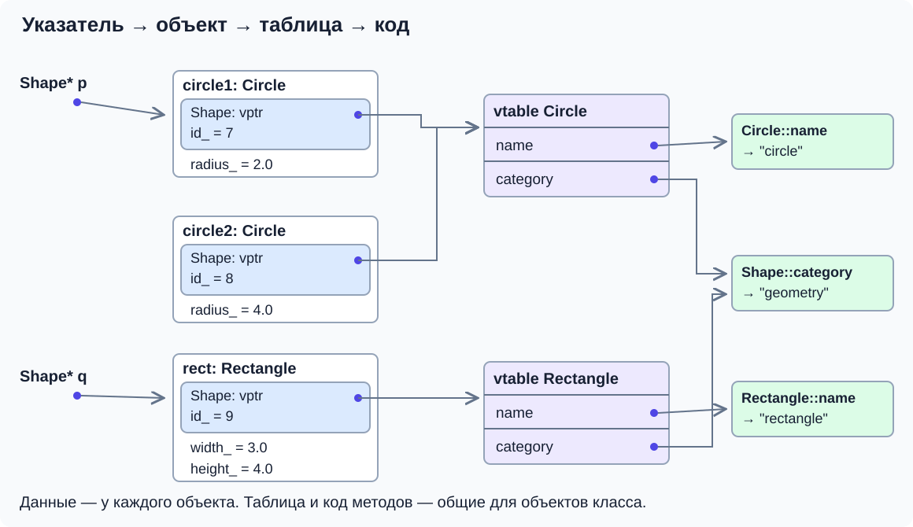
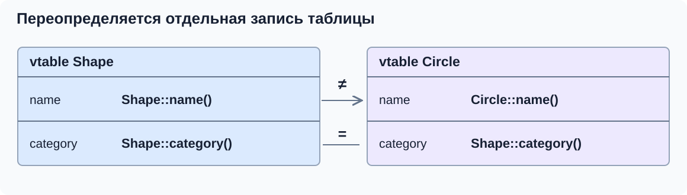
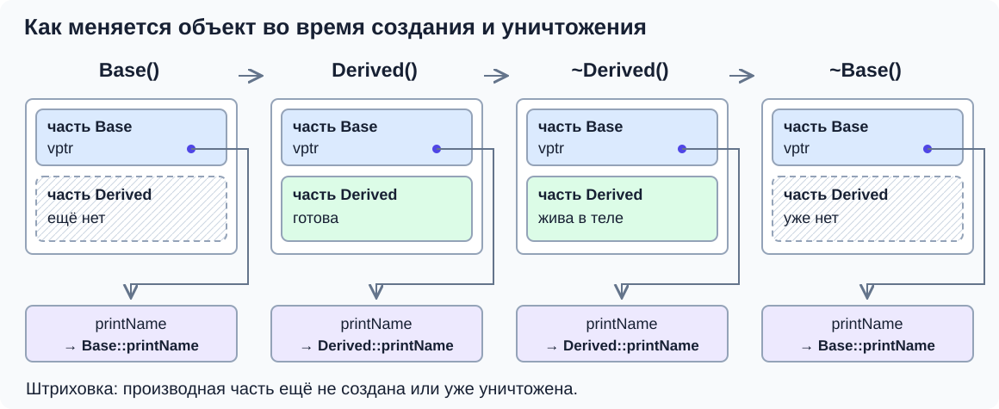

# Виртуальные функции и таблица вызовов

В первой части мы создали фигуру с идентификатором и круг с радиусом. Сохраняем эти данные и конструкторы. Теперь выясним, почему обычный метод через базовую ссылку ведёт себя иначе, чем виртуальный.

## Одно имя ещё не означает выбор по объекту

Используем `Shape` и `Circle` из первой части. Нужны `<iostream>` и `<string_view>`.

```cpp
void printName(const Shape& shape) {
    std::cout << shape.name() << '\n';
}

int main() {
    Circle circle(7, 2.0);
    std::cout << circle.name() << '\n'; // circle
    printName(circle);                 // shape
}
```

Функция `printName` получает ссылку на тот же круг. Но `name()` — обычный, **невиртуальный метод**. Компилятор выбирает его по типу выражения, через которое идёт обращение. Внутри `printName` это `const Shape&`, поэтому вызывается `Shape::name()`.

Тип выражения, известный при компиляции, называют **статическим типом**. Тип объекта, на который ссылаются во время выполнения, — **динамическим типом**. Внутри `printName(circle)` статический тип `shape` — `const Shape&`, а динамический тип объекта — `Circle`. Передача по ссылке сама по себе не делает методы виртуальными.

## virtual: реализация зависит от объекта

Чтобы `printName` получала имя конкретной фигуры, сделаем `name()` виртуальным. Состояние и конструкторы остаются прежними; добавим ещё одну виртуальную операцию `category()`, для которой круг использует базовую реализацию:

```cpp
class Shape {
public:
    explicit Shape(int id) : id_(id) {}
    virtual ~Shape() = default;

    int id() const { return id_; }
    virtual std::string_view name() const { return "shape"; }
    virtual std::string_view category() const { return "geometry"; }

protected:
    void printId() const { std::cout << "shape " << id_ << '\n'; }

private:
    int id_;
};

class Circle : public Shape {
public:
    Circle(int id, double radius) : Shape(id), radius_(radius) {}

    double radius() const { return radius_; }
    std::string_view name() const override { return "circle"; }
    void describe() const {
        printId();
        std::cout << "radius " << radius_ << '\n';
    }

private:
    double radius_;
};
```

Теперь прежний вызов `printName(circle)` напечатает `circle`. Слово **`virtual`** у базового метода разрешает выбирать реализацию по динамическому типу объекта. Функция работает с `Shape&`, а выполняется `Circle::name()`. Такое использование разных типов через общий интерфейс называется **динамическим полиморфизмом**.

То же правило работает с указателем:

```cpp
Circle circle(7, 2.0);
const Shape* pointer = &circle;
std::cout << pointer->name() << '\n'; // circle
```

Выражение `pointer->name()` вызывает метод объекта по адресу `pointer`. Указатель здесь не владеет объектом: круг остаётся локальной переменной. Виртуальность функции и владение памятью — разные вопросы.

Запись `virtual ~Shape() = default` объявляет виртуальный деструктор с реализацией от компилятора. Она нужна для безопасного удаления через базовый тип; подробно разберём это в следующей части. Копировать её в любой класс без наследования не требуется.

## override проверяет намерение

В наследнике `override` означает: «этот метод должен переопределять виртуальный метод базы». Если мы ошиблись в параметрах или забыли `const`, компилятор сообщит об ошибке:

```cpp
class Circle : public Shape {
public:
    // Ошибка: у базового name() есть const, а здесь его нет.
    std::string_view name() override { return "circle"; }
};
```

Без `override` такая функция могла бы оказаться новым методом с тем же именем, а вызов через `Shape&` продолжил бы использовать базовую реализацию. Поэтому переопределения помечаем `override`. Повторять `virtual` в наследнике не нужно: переопределённый метод остаётся виртуальным и в дальнейших наследниках.

Имена и параметры, а также `const` и квалификаторы ссылок метода должны подходить для переопределения. Возвращаемый тип обычно совпадает; специальное исключение для указателей и ссылок разобрано далее. Для `noexcept` правило отдельное: если база обещает не бросать исключений, переопределение не может ослабить обещание. Если база такого обещания не даёт, наследник может добавить `noexcept`.

Метод можно пометить `final`, чтобы запретить дальнейшее переопределение: `std::string_view name() const override final`. Запись `class Circle final : public Shape` запрещает наследование от `Circle` целиком. Для обычного первого переопределения достаточно `override`.

## Как устроена таблица виртуальных функций

Мы уже знаем результат вызова: через `Shape&` выполняется `Circle::name()`. Теперь разберём, как программа находит эту функцию. Ниже описана распространённая реализация компиляторов для простого одиночного наследования. Стандарт C++ задаёт поведение виртуальных вызовов, но не требует конкретного устройства таблиц и объектов.

### Где находятся функции и что хранит объект

Обычные и виртуальные методы не копируются внутрь каждого объекта. Их машинный код находится отдельно, и разные объекты могут вызывать одну реализацию метода, передавая ей разные `this` — адреса объектов, с которыми нужно работать.

**Таблица виртуальных функций**, или **vtable**, содержит адреса реализаций виртуальных методов и служебные записи. У каждого виртуального метода в рассматриваемом базовом интерфейсе есть определённое место в таблице — **слот**. В таблице для `Circle` слот `name` ведёт к `Circle::name`, а в таблице для `Shape` — к `Shape::name`.

Чтобы найти подходящую таблицу по объекту, в его полиморфной базовой части обычно хранится скрытый указатель — **vptr**. Его не нужно объявлять или заполнять вручную: необходимые действия добавляет компилятор при создании объекта. У полностью построенного круга этот указатель ведёт к таблице, обеспечивающей поведение круга через интерфейс `Shape`.

При этом `Shape*` хранит адрес базовой части объекта. Сам указатель не хранит имя производного класса или отдельную копию таблицы. Путь к реализации проходит **через объект**.



На схеме показаны слоты `name` и `category`; записи деструктора и служебная информация опущены. Номера и физический порядок слотов зависят от реализации компилятора. В этом простом случае у полностью созданных объектов одного класса указатели `vptr` ведут к общей таблице: двум кругам не нужны две копии `vtable`. Данные у кругов при этом собственные.

### Несколько слотов и частичное переопределение

У нашего интерфейса две виртуальные операции: `name()` и `category()`. В таблице круга запись `name` ведёт к `Circle::name`, а запись `category` — к унаследованной `Shape::category`. Новая таблица не означает, что наследник заново реализовал все методы базы.



```cpp
Circle circle(7, 2.0);
const Shape& shape = circle;
std::cout << shape.name() << '\n';     // circle
std::cout << shape.category() << '\n'; // geometry
```

Оба вызова виртуальные и работают с одним объектом, но обращаются к разным слотам. В первом случае вызывается метод наследника, во втором — метод базы. Обычный `id()` в таблицу виртуальных функций не попадает: он по-прежнему читает состояние базовой части.

### Что решается при компиляции, а что — при выполнении

Добавим к предыдущим `Shape` и `Circle` ещё один производный класс и две функции:

```cpp
class Rectangle : public Shape {
public:
    Rectangle(int id, double width, double height)
        : Shape(id), width_(width), height_(height) {}

    std::string_view name() const override { return "rectangle"; }

private:
    double width_;
    double height_;
};

void printThroughPointer(const Shape* shape) {
    std::cout << shape->name() << '\n';
}

void printThroughReference(const Shape& shape) {
    std::cout << shape.name() << '\n';
}
```

Для **`shape->name()` через указатель** разделим работу на два этапа.

При компиляции функции `printThroughPointer`:

1. Из типа `const Shape*` компилятор знает, какие методы доступны. Метод с именем `name` ищется в интерфейсе `Shape`; проверяются аргументы и доступ.
2. Компилятор видит, что выбранный метод виртуальный, и знает соответствующий ему слот таблицы.
3. Генерируется код косвенного вызова через этот слот. Выбирать между кругом и прямоугольником по цепочке `if` не требуется.

При выполнении вызова с непустым указателем на живой объект:

1. По значению `shape` находится базовая часть конкретного объекта.
2. Из неё читается скрытый указатель `vptr` на подходящую таблицу.
3. Из известного слота `name` берётся адрес функции. У круга там `Circle::name`, у прямоугольника — `Rectangle::name`.
4. Функция вызывается для того же объекта: ей передаётся соответствующий `this`.

**Из статического типа выбирается операция и её слот; через конкретный объект находится таблица и реализация этой операции.** Поэтому один скомпилированный вызов может выполнять разные функции.

### Один указатель, разные объекты

```cpp
Circle circle(7, 2.0);
Rectangle rectangle(8, 3.0, 4.0);

const Shape* selected = &circle;
printThroughPointer(selected);   // circle

selected = &rectangle;
printThroughPointer(selected);   // rectangle

printThroughReference(circle);   // circle
printThroughReference(rectangle); // rectangle
```

Тип `selected` остался `const Shape*`, и тело `printThroughPointer` не изменилось. Изменился адрес объекта. Теперь программа читает `vptr` прямоугольника и получает другую запись **того же слота** `name`. Таблица круга при этом никуда не переписывается.

Компилятор не перебирает все классы-наследники и не ищет строку `"name"` во время выполнения: место нужной операции известно заранее.

### Почему со ссылкой работает так же

У параметра `const Shape& shape` нет отдельного объекта `Shape`: ссылка обозначает базовую часть исходного круга или прямоугольника. Поэтому для `shape.name()` можно найти тот же объект, тот же `vptr` и тот же слот `name`, что и при вызове через указатель.

Различается форма обращения — `pointer->name()` или `reference.name()`. Принцип выбора виртуальной реализации один и тот же. Ссылка не получает собственной `vtable`, а создание базовой ссылки не меняет динамический тип исходного объекта.

### Чем отличается невиртуальный вызов

Если убрать `virtual` у `Shape::name`, вызов через `Shape*` или `Shape&` выбирается по статическому типу и ведёт к `Shape::name`. Смотреть слот виртуальной функции для этой операции не требуется. Наличие других виртуальных методов в классе не делает `name` виртуальным автоматически.

Если компилятор может доказать конкретный тип объекта, он вправе заменить виртуальный вызов прямым и даже встроить функцию. Это **девиртуализация**: результат остаётся тем же, но фактического чтения таблицы может не быть.

**Проверьте себя:** что изменится при `selected = &rectangle` — тип указателя, слот `name` или объект и найденная через него таблица? Будет ли другой механизм выбора, если передать прямоугольник через `Shape&`?

**Ответ:**

Меняется значение указателя и объект, к которому он ведёт. Статический тип и выбранный слот остаются теми же; таблица нового объекта даёт адрес другой реализации. Через базовую ссылку выбор виртуальной реализации происходит по тому же принципу.

## Передача по значению срезает объект

Сравним две функции на последней версии классов:

```cpp
void printReference(const Shape& shape) {
    std::cout << shape.name() << '\n';
}

void printValue(Shape shape) {
    std::cout << shape.name() << '\n';
}

Circle circle(7, 2.0);
printReference(circle); // circle
printValue(circle);     // shape
```

`printReference` не создаёт новый объект. `printValue` создаёт отдельный параметр типа `Shape`, копируя только базовую часть круга. Поля и поведение `Circle` в него не попадают. Это **срезка объекта** (*object slicing*).

Виртуальный вызов во второй функции работает правильно: динамический тип нового параметра действительно `Shape`. Виртуальность не восстанавливает уже потерянную производную часть. Та же проблема возникает при `Shape copy = circle` или добавлении круга в `std::vector<Shape>`.

Чтобы сохранить исходный объект и его поведение, передавайте базовую ссылку или указатель. Чтобы владеть разными фигурами в коллекции, понадобятся владеющие указатели — к ним перейдём далее. Если базовый класс абстрактный, создать его значение вообще нельзя, и такая срезка будет ошибкой компиляции.

## Виртуальный вызов на разных стадиях жизни объекта

Мы описали таблицу **полностью построенного** круга. Но пока выполняется конструктор базы, производная часть ещё не готова; при выполнении деструктора базы она уже уничтожена. Поэтому виртуальный вызов из конструктора или деструктора базы не переходит в реализацию наследника.

Посмотрим на самостоятельный пример с трассировкой. Здесь `Base` и `Derived` нужны только для наблюдения за стадиями; наши фигуры менять не нужно.

```cpp
class Base {
public:
    Base() { printName(); }
    virtual ~Base() { printName(); }
    virtual void printName() const { std::cout << "Base\n"; }
};

class Derived : public Base {
public:
    Derived() { printName(); }
    ~Derived() override { printName(); }
    void printName() const override { std::cout << "Derived\n"; }
};

int main() {
    Derived object;
}
```

Вывод:

```text
Base
Derived
Derived
Base
```

Первый вызов происходит в конструкторе базы, второй — в теле конструктора наследника. Затем выполняются тела деструкторов наследника и базы. На каждом этапе выбирается реализация для класса, чей конструктор или деструктор сейчас выполняется.



В типичной реализации компилятор по мере создания и уничтожения частей устанавливает `vptr` для соответствующей стадии. Поэтому схема «любой вызов всегда использует таблицу самого производного класса» неполна: она подходит для готового объекта, но требует уточнения для конструкторов и деструкторов.

Для `Shape` и `Circle` правило то же. Виртуальный вызов из конструктора `Shape` не должен рассчитывать на уже готовый `radius_` и реализацию `Circle`. Работу, требующую готового производного объекта, вызывают после завершения создания.

В следующей части появятся чисто виртуальные функции. Виртуальный вызов такой функции прямо или косвенно из конструктора или деструктора соответствующей базы имеет неопределённое поведение; наличие определения чисто виртуальной функции само по себе это правило не отменяет.

**Проверьте себя:** почему добавление `virtual` не исправит `printValue`? Почему вызов `printName()` из конструктора `Base` не печатает `Derived`?

**Ответ:**

Параметр по значению уже стал отдельным объектом `Shape`; виртуальный вызов выбирает реализацию этого объекта. В конструкторе базы производная часть ещё не создана, и виртуальный вызов использует реализацию базы; позднее, в теле конструктора наследника, уже доступно его поведение.

Далее: [виртуальный деструктор и использование интерфейса](03-interfaces-and-ownership.md).
