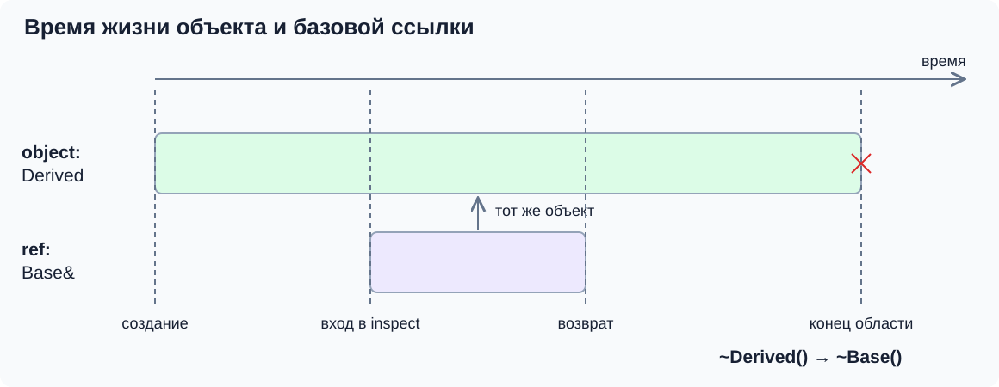
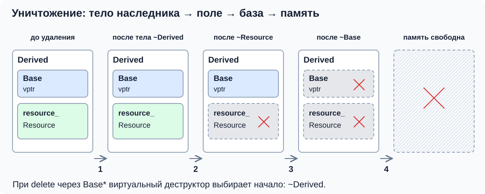
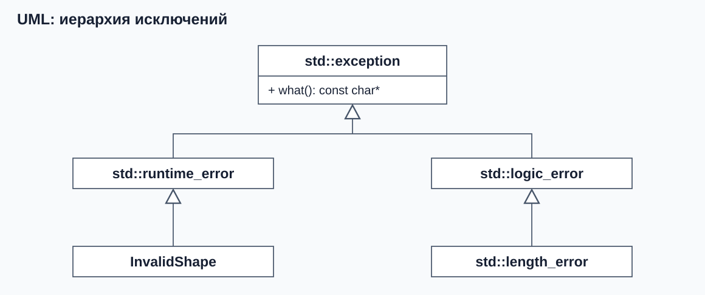
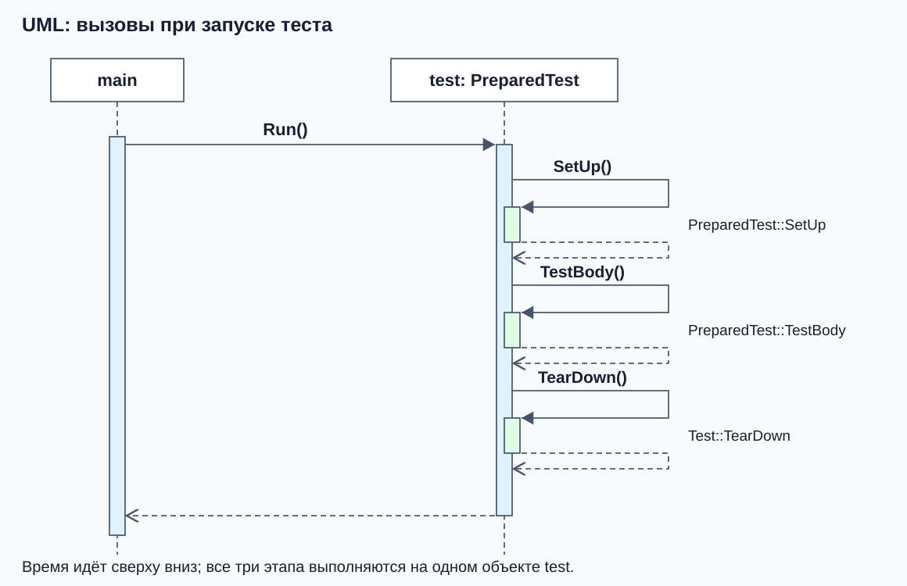

# Виртуальный деструктор и использование интерфейса

Мы научились выбирать метод через базовую ссылку и указатель. Теперь применим этот механизм к уничтожению, добавим к знакомой фигуре обязательную операцию площади и вернёмся к исключениям и Google Test из предыдущих занятий.

## Почему деструктор должен быть виртуальным

Обычный виртуальный метод выбирает поведение конкретного объекта через базовый интерфейс. Для уничтожения нужен такой же выбор: если владелец знает только `Shape*`, как ему начать уничтожение полного круга?

### Базовая ссылка сама ничего не уничтожает

Сначала отделим ссылку от владельца. Для этого примера используем самостоятельные классы `Base` и `Derived` с **невиртуальными** деструкторами; нужен `<iostream>`:

```cpp
class Base {
public:
    ~Base() { std::cout << "~Base\n"; }
};

class Derived : public Base {
public:
    ~Derived() { std::cout << "~Derived\n"; }
};

void inspect(const Base& base) {
    // Параметр обозначает существующий объект; новая Base не создаётся.
}

int main() {
    Derived object;
    inspect(object);
    std::cout << "leaving scope\n";
}
```

Вывод: `leaving scope`, затем `~Derived`, затем `~Base`. Здесь всё корректно: локальная переменная объявлена как `Derived`, и при выходе из её области видимости компилятор знает, какой объект уничтожает. Вызов функции с базовой ссылкой не меняет тип переменной и не передаёт владение. При выходе из `inspect` деструктор обозначаемого объекта не вызывается.



Проблема возникает при **удалении через базовый указатель**, а не от самого наличия ссылки.

### Удаление через базовый указатель

Теперь представим другой способ владения. Следующие строки с теми же невиртуальными деструкторами показывают ошибку; запускать их как демонстрацию ожидаемого вывода нельзя:

```cpp
Base* pointer = new Derived;
delete pointer; // Ошибка: неопределённое поведение.
```

`new Derived` создаёт полный объект, но в точке `delete` статический тип указателя — `Base*`. Без виртуального деструктора базы такое удаление имеет **неопределённое поведение**. Объяснение «вызовется только `~Base`» показывает возможную потерю очистки наследника, но язык не гарантирует даже этот результат.

Почему недостаточно убрать только базовую часть? У наследника могут быть поля-владельцы: `std::unique_ptr`, строки, контейнеры, файлы. Полное уничтожение должно выполнить тело деструктора наследника и уничтожить его поля. Базовый класс не знает, какие ресурсы добавили будущие наследники, и не может самостоятельно выполнить их очистку.

### Виртуальный деструктор выбирает начало цепочки

Исправим базовый класс и добавим поле, чтобы видеть все этапы. Это отдельная версия примера; нужен `<memory>`:

```cpp
class Base {
public:
    virtual ~Base() { std::cout << "~Base\n"; }
};

class Resource {
public:
    ~Resource() { std::cout << "~Resource\n"; }
};

class Derived : public Base {
public:
    ~Derived() override { std::cout << "~Derived body\n"; }

private:
    Resource resource_;
};

int main() {
    std::unique_ptr<Base> owner = std::make_unique<Derived>();
    std::cout << "reset owner\n";
    owner.reset();
    std::cout << "object deleted\n";
}
```

Результат:

```text
reset owner
~Derived body
~Resource
~Base
object deleted
```

`owner` хранит базовый указатель, но объект по-прежнему имеет тип `Derived`. При `reset()` умный указатель запускает удаление через `Base*`. Виртуальный деструктор позволяет начать с деструктора `Derived`, затем автоматически уничтожается `resource_`, затем выполняется деструктор `Base`. После уничтожения объекта освобождается выделенная под него память.



В терминах уже знакомой реализации с `vtable` компилятор использует связанную с объектом таблицу и записи виртуального деструктора. Найденная операция обеспечивает уничтожение полного объекта и освобождение памяти при `delete`. Точная реализация может использовать несколько служебных вариантов деструктора; не следует считать, что в любой таблице есть ровно одна запись `~Base`.

Виртуальность нужна для **выбора начала** уничтожения через базовый тип. После выбора `Derived` вызовы деструкторов его полей и базы происходят автоматически по правилам времени жизни. Писать внутри `~Derived` ручной вызов `~Base()` не нужно: это привело бы к повторному уничтожению базовой части.

### Даже если у базы нет собственных ресурсов

У базы может не быть собственных ресурсов, но `virtual ~Shape() = default` всё равно нужен для выбора начала уничтожения наследника через `Shape*`. `= default` просит компилятор сформировать обычную реализацию деструктора и не отменяет виртуальность.

Если у наследника вообще не написан деструктор, компилятор создаёт его сам. При виртуальном деструкторе базы он тоже виртуальный и уничтожает поля наследника. Пометка `override` у явно написанного деструктора полезна как проверка намерения, но не она делает деструктор виртуальным.

Другие виртуальные методы **не делают деструктор виртуальным автоматически**. Даже если в `Shape` уже объявлен `virtual double area() const`, для безопасного удаления через `Shape*` деструктор нужно объявить виртуальным отдельно.

Для интерфейса, через который владеют объектами, используем публичный виртуальный деструктор. Если класс не предназначен для удаления через базовый тип, другой вариант контракта — защищённый невиртуальный деструктор: внешний `delete Base*` будет запрещён.

**Проверьте себя:** нужен ли виртуальный деструктор для локального `Derived object`, который временно передали через `Base&`? А для `std::unique_ptr<Base>`, владеющего `Derived`? Достаточно ли того, что у базы виртуальный `name()`?

**Ответ:**

Локальный объект уничтожается по типу своего объявления; сама базовая ссылка не требует виртуального деструктора. У стандартного `unique_ptr<Base>` удаление происходит через `Base*`, поэтому для производного объекта деструктор базы должен быть виртуальным. Виртуальность другого метода на деструктор не распространяется.

### Связь с правилом пяти

В [занятии 4](../../04-move-and-smart-pointers/theory/02-moving-vector.md) мы выяснили, что пользовательский деструктор влияет на появление move-операций. Это относится и к объявлению `virtual ~Shape() = default`: деструктор объявлен нами, поэтому неявные move-конструктор и move-присваивание у самого `Shape` не появятся.

При этом перемещение наследника не обязательно станет ошибкой. Если базу можно копировать, её копирующий конструктор может принять аргумент, полученный через `std::move`. Тогда производный объект будет перемещать одни части и копировать базовую часть. Это продолжение правила «`std::move` сам ничего не перемещает».

Если конкретному базовому классу действительно нужны обе группы операций, их можно явно объявить в его публичной части:

```cpp
Shape(const Shape&) = default;
Shape& operator=(const Shape&) = default;
Shape(Shape&&) noexcept = default;
Shape& operator=(Shape&&) noexcept = default;
```

Для нашего базового состояния из одного `int` такие операции безопасны без исключений. В другом классе это нужно проверять по базе и полям. Это не универсальная заготовка для всех интерфейсов: иногда копирование через базовый тип специально запрещают, чтобы исключить срезку или частичное присваивание. В практике мы не переносим фигуры по значению, а перемещаем `unique_ptr`, поэтому сами фигуры при передаче владельцев не копируются и не перемещаются.

## От готовой фигуры к абстрактному интерфейсу

До сих пор `Shape` мог существовать самостоятельно: мы давали ему идентификатор и имя. Но у «просто фигуры» нет размеров и формулы площади. Не будем возвращать условный ноль: добавим требование к конкретным наследникам. Существующие `id`, `name` и `category` сохраняются; добавляется `area`.

```cpp
class Shape {
public:
    explicit Shape(int id) : id_(id) {}
    virtual ~Shape() = default;

    int id() const { return id_; }
    virtual std::string_view name() const { return "shape"; }
    virtual std::string_view category() const { return "geometry"; }
    virtual double area() const = 0;

protected:
    void printId() const { std::cout << "shape " << id_ << '\n'; }

private:
    int id_;
};
```

`= 0` после объявления виртуального метода означает **чисто виртуальную функцию**. Это не возврат нуля и не значение по умолчанию. Класс, в котором остаётся хотя бы одна чисто виртуальная операция без конкретного переопределения, является **абстрактным**: создать отдельный объект `Shape shape;` нельзя.

При этом `Shape&`, `Shape*` и базовая часть внутри наследника допустимы. Абстрактный класс может иметь поля, конструкторы и обычные методы. Наш `Shape` сохраняет идентификатор и готовые методы, но теперь задаёт ещё и **интерфейс** вычисления площади — операцию и договорённости о её поведении.

Чтобы стать конкретным классом, наследник должен реализовать все оставшиеся чисто виртуальные операции. Если он этого не сделал, то тоже остаётся абстрактным.

Запишем две реализации. Нужны `<numbers>` и `<stdexcept>`; `std::numbers::pi` — готовая константа π из C++20.

```cpp
class Circle final : public Shape {
public:
    Circle(int id, double radius) : Shape(id), radius_(radius) {
        if (!(radius > 0.0)) {
            throw std::invalid_argument("radius must be positive");
        }
    }

    double radius() const { return radius_; }
    std::string_view name() const override { return "circle"; }
    void describe() const {
        printId();
        std::cout << "radius " << radius_ << '\n';
    }

    double area() const override {
        return std::numbers::pi * radius_ * radius_;
    }

private:
    double radius_;
};

class Rectangle final : public Shape {
public:
    Rectangle(int id, double width, double height)
        : Shape(id), width_(width), height_(height) {
        if (!(width > 0.0) || !(height > 0.0)) {
            throw std::invalid_argument("sides must be positive");
        }
    }

    std::string_view name() const override { return "rectangle"; }
    double area() const override { return width_ * height_; }

private:
    double width_;
    double height_;
};
```

Для примера используем обычные конечные положительные размеры. Валидация не даёт создать фигуру с нулевым или отрицательным размером. `final` здесь фиксирует, что дальнейшие наследники этих двух классов нам не нужны.

Общая функция ничего не знает о формулах. Для вывода нужен `<iostream>`:

```cpp
void printArea(const Shape& shape) {
    std::cout << shape.area() << '\n';
}

Circle circle(7, 2.0);
Rectangle rectangle(8, 3.0, 4.0);
printArea(circle);    // приблизительно 12.5664
printArea(rectangle); // 12
```

Добавление ещё одной фигуры не требует менять `printArea`: новый класс реализует тот же контракт. В этом и состоит польза общего интерфейса.

## Разные фигуры в одной коллекции

Из [занятия 4](../../04-move-and-smart-pointers/README.md) уже знаком `std::unique_ptr`. Он владеет одним объектом и вызывает его удаление при уничтожении владельца. Теперь используем его с базовым типом. Дополнительно нужны `<memory>` и `<vector>`:

```cpp
std::vector<std::unique_ptr<Shape>> shapes;
shapes.push_back(std::make_unique<Circle>(7, 2.0));
shapes.push_back(std::make_unique<Rectangle>(8, 3.0, 4.0));

for (const auto& shape : shapes) {
    printArea(*shape);
}
```

`std::vector` здесь — стандартный контейнер, а не наш учебный `Vector`. Он хранит владельцев, а сами фигуры находятся в отдельно выделенной памяти. `make_unique<Circle>` создаёт полный круг. При передаче в контейнер `unique_ptr<Circle>` преобразуется перемещением в `unique_ptr<Shape>`: передаётся владение тем же объектом, срезки нет.

В цикле `shape` — ссылка на очередной умный указатель; `*shape` обозначает фигуру, на которую он указывает. `printArea` получает невладеющую ссылку и вызывает виртуальную операцию. Здесь все указатели непустые, потому что мы добавили результаты успешного `make_unique`.

Когда контейнер уничтожится, каждый `unique_ptr<Shape>` удалит свою фигуру через базовый указатель. Умный указатель избавляет от ручного `delete`, но **не отменяет требование к виртуальному деструктору**. Обёртка управляет владением, а базовый класс определяет, допустимо ли такое удаление.

Наследование также не добавляет полиморфного копирования: копия базовой части не становится копией полного круга. `unique_ptr` вообще не копируется. Если понадобится копировать коллекцию с сохранением конкретных типов фигур, потребуется отдельный контракт копирования; в этом занятии достаточно единоличного владения.

**Проверьте себя:** что мешает создать `Shape`? Почему `unique_ptr<Shape>` допустим, но не исправляет отсутствие виртуального деструктора? Потребуется ли менять `printArea`, чтобы добавить треугольник?

**Ответ:**

У `Shape` есть чисто виртуальная операция `area`, поэтому класс абстрактный. Указатель может указывать на базовую часть конкретной фигуры, не создавая отдельный абстрактный объект. `unique_ptr` управляет удалением через сохранённый тип указателя; для нашего `unique_ptr<Shape>` деструктор `Shape` должен быть виртуальным. Для треугольника достаточно реализовать тот же интерфейс и соблюдать его контракт, а функция `printArea` останется прежней.

## Возвращаемся к исключениям

В [занятии 3](../../03-exceptions/README.md) мы ловили стандартные ошибки, но отложили их иерархию до наследования. Теперь можно объяснить общий обработчик.

`std::exception` — базовый класс стандартных исключений. `std::runtime_error` наследует его и хранит текст сообщения. От этого готового класса удобно получить свой тип ошибки. Для следующего примера нужны `<exception>`, `<stdexcept>` и `<iostream>`:

```cpp
class InvalidShape : public std::runtime_error {
public:
    explicit InvalidShape(const char* message)
        : std::runtime_error(message) {}
};

void validateRadius(double radius) {
    if (!(radius > 0.0)) {
        throw InvalidShape("radius must be positive");
    }
}
```

`InvalidShape` позволяет отличить ошибку фигуры по типу, а хранение сообщения и реализацию `what()` наследует от `std::runtime_error`. Собственный `what()` и ручной буфер для текста не нужны.



Здесь используется та же UML-нотация обобщения: пустой треугольник указывает на базовый класс. Так путь от `InvalidShape` к `std::exception` можно прочитать прямо по связям.

Сначала обработаем конкретную ошибку:

```cpp
try {
    validateRadius(-1.0);
} catch (const InvalidShape& error) {
    std::cout << "shape: " << error.what() << '\n';
} catch (const std::exception& error) {
    std::cout << "other: " << error.what() << '\n';
}
```

Вывод — `shape: radius must be positive`. При выборе `catch` учитывается публичная однозначная базовая часть объекта исключения; обработчики проверяются сверху вниз. Сам выбор обработчика — правило механизма исключений, а не виртуальный вызов через таблицу.

Теперь уберём конкретный обработчик:

```cpp
try {
    validateRadius(-1.0);
} catch (const std::exception& error) {
    std::cout << "base: " << error.what() << '\n';
}
```

Вывод — `base: radius must be positive`. Базовая ссылка обозначает исходный объект ошибки, не создавая срезанную копию. А вот **`error.what()` — виртуальный вызов**: для нашего объекта используется унаследованная реализация `std::runtime_error::what()`. Её контракт включает `const` и `noexcept`; собственное переопределение должно их учитывать.

Если поставить общий `catch (const std::exception&)` первым, он перехватит `InvalidShape`, и до конкретного обработчика дело не дойдёт. Поэтому исключение бросаем по значению, обычно ловим по `const` ссылке и располагаем конкретные обработчики перед общими.

В итоговой практике конструкторы фигур бросают `InvalidShape` вместо общего `std::invalid_argument`. Это осознанное уточнение контракта ошибки после знакомства с наследованием; данные фигур и формулы остаются прежними.

## Возвращаемся к фикстуре Google Test

В занятии 5 библиотека вызывала нашу подготовку `SetUp()`, хотя сама написана без знания класса нашей фикстуры. Покажем принцип на небольшой модели. Это **не код Google Test**: здесь только успешный путь подготовки, выполнения и очистки, без макросов, проверок и обработки исключений.

```cpp
class Test {
public:
    virtual ~Test() = default;

    void Run() {
        SetUp();
        TestBody();
        TearDown();
    }

protected:
    virtual void SetUp() {}
    virtual void TestBody() = 0;
    virtual void TearDown() { std::cout << "cleanup\n"; }
};

class PreparedTest : public Test {
protected:
    void SetUp() override {
        value_ = 7;
        std::cout << "prepare\n";
    }

    void TestBody() override {
        std::cout << "value = " << value_ << '\n';
    }

private:
    int value_ = 0;
};

int main() {
    PreparedTest test;
    Test& base = test;
    base.Run();
}
```

Результат:

```text
prepare
value = 7
cleanup
```

`Run()` — обычный метод базы, но его внутренние вызовы виртуальны. Они работают с тем же `this`, указывающим на готовый `PreparedTest`. `SetUp` и `TestBody` выбираются из наследника, `TearDown` остаётся базовым. Это ещё один пример разных записей одной таблицы.



Это **UML-диаграмма последовательности**. Время идёт сверху вниз. Пунктирная вертикаль под участником — его **линия жизни**, узкие прямоугольники — выполнения методов. Сплошная стрелка с закрашенным наконечником показывает синхронный вызов, пунктирная с открытым — возврат.

Петли к собственной линии жизни показывают вызовы на том же объекте `test`. Отдельных объектов базы и наследника здесь нет: `Run` выполняет методы одного готового `PreparedTest`. Подписи справа показывают, где находится выбранная реализация.

`protected` не мешает методу `Test::Run` вызывать эти операции. Внешний код обращается к публичному `Run`, а устройство подготовки остаётся внутри иерархии.

В настоящем Google Test `TEST_F` создаёт дополнительный класс-наследник нашей фикстуры с реализацией `TestBody`. Поэтому схема из занятия 5 теперь читается полностью: базовый интерфейс библиотеки → подготовка фикстуры → тело конкретного теста → очистка. `SetUp` вызывается после создания полного объекта, а не из конструктора базового класса; поэтому здесь работает поведение наследника.

**Проверьте себя:** почему выбор `catch` не является виртуальным вызовом, а `error.what()` является? Может ли обычный метод базы вызвать виртуальную реализацию наследника?

**Ответ:**

Обработчик выбирается правилами сопоставления типа исключения и порядка `catch`. Затем `what()` вызывается через базовую ссылку как виртуальный метод. Обычный метод базы может вызвать виртуальный метод для того же готового объекта: так `Test::Run` достигает `PreparedTest::SetUp` и `PreparedTest::TestBody`.

## Справочно: скрытие имён, аргументы по умолчанию и несколько баз

### Похожие записи с разным смыслом

**Скрытие имени и перегрузка.** Новый метод наследника с тем же именем может скрыть сразу несколько методов базы:

```cpp
class Base {
public:
    void set(int) {}
};

class Derived : public Base {
public:
    using Base::set;
    void set(int, int) {}
};

Derived object;
object.set(1);    // Base::set, доступен благодаря using
object.set(1, 2); // Derived::set
```

Без `using Base::set` поиск имени через `Derived` нашёл бы только двухаргументный метод, и первый вызов не собрался бы. Это вопрос поиска имени и перегрузки, а не выбора виртуальной реализации.

**Аргументы по умолчанию.** Они выбираются по статическому типу обращения, даже у виртуальной функции. Если база объявляет `virtual void draw(int scale = 1) const`, а наследник — `void draw(int scale = 2) const override`, вызов через базовую ссылку передаст `1` в реализацию наследника; вызов через производный объект передаст `2`. Поэтому разные значения по умолчанию у переопределений затрудняют чтение кода.

**Ковариантный возврат.** База может объявить виртуальную функцию, возвращающую `Base*`, а наследник переопределить её с результатом `Derived*`. Аналогичное послабление есть для ссылок при соблюдении правил доступного однозначного наследования и квалификаторов. Это называется ковариантностью. Оно не распространяется на `std::unique_ptr<Derived>` вместо `std::unique_ptr<Base>`: это разные типы обёрток, и в сигнатуре переопределения они должны совпадать.

**Чисто виртуальная функция и определение.** У чисто виртуальной функции может быть определение вне класса; наличие тела не убирает `= 0` и абстрактность. Чисто виртуальному деструктору определение необходимо, потому что деструктор базы участвует в уничтожении наследника. В нашем примере проще использовать обычный виртуальный деструктор с `= default`.

### Несколько базовых классов

Запись `class Document : public Printable, public Savable` означает наследование от двух баз. Она бывает полезна для нескольких независимых интерфейсов. Если у баз есть одинаковые имена методов, может потребоваться явно указать, к какой базе относится обращение.

Если два промежуточных класса наследуют общую базу, а затем один класс наследует их обоих, получается **ромб**. При обычном наследовании итоговый объект содержит две отдельные части общей базы, и преобразование к ней может стать неоднозначным.

Запись `virtual public Base` у обеих промежуточных ветвей позволяет итоговому объекту иметь одну общую виртуальную базовую часть. Её конструктор выбирает самый производный класс; виртуальные базы создаются раньше обычных баз и полей. Это **виртуальное наследование**. Оно решает вопрос общих базовых частей и не связано с пометкой метода `virtual`. Для иерархии `Shape` оно не требуется.

Далее: [демонстрационный проект](../practice/README.md).
