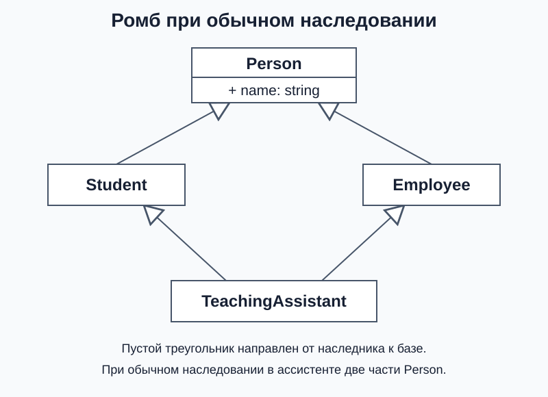
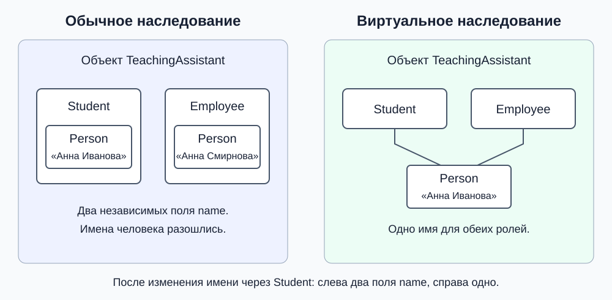

# Несколько баз и проблема ромба

В нашей модели университета ассистент курса одновременно учится и работает: он является студентом и сотрудником. Код учебной части работает со `Student`, а код отдела кадров — с `Employee`. Ассистент должен подходить к обоим интерфейсам.

До сих пор у класса была одна база, указанная после двоеточия, — одна **непосредственная база**. Теперь понадобятся две. Сначала объединим две роли, затем добавим общие данные человека и выясним, сколько раз они окажутся в объекте.

Каждый следующий вариант заменяет объявления классов предыдущего; объединять разные варианты в одном пространстве имён не нужно.

## Один объект с двумя базовыми интерфейсами

Пока не будем хранить персональные данные. Покажем операции двух ролей: студент учится, сотрудник работает; у каждого есть своя карточка. Нужен `<iostream>`.

```cpp
struct Student {
    virtual ~Student() = default;
    void study() const { std::cout << "study\n"; }
    void printCard() const { std::cout << "student card\n"; }
};

struct Employee {
    virtual ~Employee() = default;
    void work() const { std::cout << "work\n"; }
    void printCard() const { std::cout << "employee card\n"; }
};

struct TeachingAssistant : public Student, public Employee {};
```

После двоеточия перечислены две базы; `public` относится к каждой отдельно. Это **множественное наследование**. Полный объект `TeachingAssistant` содержит часть `Student` и часть `Employee`.

Доступ к каждой базе выбирается независимо. В `class TeachingAssistant : public Student, Employee` база `Employee` оказалась бы закрытой по умолчанию для `class`. У `struct` пропущенное обозначение доступа означало бы `public`.

```cpp
void startStudy(const Student& student) { student.study(); }
void startWork(const Employee& employee) { employee.work(); }

TeachingAssistant assistant;
startStudy(assistant); // study
startWork(assistant);  // work
```

Обе функции работают с одним ассистентом через разные базовые части. Копий не создаётся. Здесь базы уже содержат реализации операций. Если нужно только задать требования к наследнику, их можно оформить чисто виртуальными методами, как интерфейс `Shape` в занятии 6.

**Зачем C++ допускает несколько баз:** один объект может подставляться в несколько независимых интерфейсов и использовать их реализации. В нашей модели ассистент подходит и к интерфейсу студента, и к интерфейсу сотрудника. Выбирать одну из этих ролей не требуется.

Если же объект просто использует другой объект, наследование для этого не обязательно: можно хранить поле или передать параметр метода. Например, ассистент пользуется компьютером, но от этого не становится компьютером. Наследование должно выражать подходящую подстановку через базовый интерфейс.

## Как выбрать операцию при совпадении имён

В обеих базах есть `printCard()`. У студента это студенческая карточка, у сотрудника — карточка сотрудника. При вызове через ассистента нужно выбрать, какую из них печатать. Нужную базу можно указать записью `объект.База::метод()`:

```cpp
TeachingAssistant assistant;
// assistant.printCard(); // Ошибка: какая карточка нужна?
assistant.Student::printCard();  // student card
assistant.Employee::printCard(); // employee card
```

Можно также определить собственный `TeachingAssistant::printCard()`, который задаст общее поведение — например, напечатает обе карточки.

Это совпадение имён двух независимых баз. Самих ролей две, поэтому необходимость выбрать карточку естественна. Но у студента и сотрудника есть ещё общие данные одного человека. С ними появляется другая проблема.

## Общий предок: студент и сотрудник являются людьми

Добавим `Person`, который хранит имя человека. И `Student`, и `Employee` являются разновидностями `Person`, поэтому наследуют этот класс. Ассистент остаётся и студентом, и сотрудником.

Для имени используем `std::string` из `<string>` — стандартный класс строки. Конструктор получает имя по константной ссылке и копирует его в поле. Операции учёбы, работы и печати карточек в следующих версиях опустим: сейчас важно проследить общие данные и их создание.

```cpp
struct Person {
    explicit Person(const std::string& name) : name(name) {}
    virtual ~Person() = default;
    std::string name;
};

struct Student : public Person {
    explicit Student(const std::string& name) : Person(name) {}
};

struct Employee : public Person {
    explicit Employee(const std::string& name) : Person(name) {}
};

struct TeachingAssistant : public Student, public Employee {
    explicit TeachingAssistant(const std::string& name)
        : Student(name), Employee(name) {}
};
```

Получилась иерархия с двумя путями от `TeachingAssistant` к `Person`. Такая форма называется **ромбом наследования**:



Прямоугольники на этой UML-диаграмме обозначают классы. Пустой треугольник указывает на базовый класс; `+ name: string` — публичное поле имени. Здесь нарисованы связи типов. Одна вершина `Person` на схеме ещё не означает одну часть `Person` внутри объекта.

## В чём проблема двух частей Person

Человек один, и его имя должно быть одним общим состоянием. Но при обычном наследовании каждая ветвь создаёт свою базовую часть. В одном `TeachingAssistant` оказываются **две части `Person` и две отдельные строки `name`**: одна внутри `Student`, другая внутри `Employee`.

Даже если передать обеим ветвям одинаковое имя, прямое обращение останется неоднозначным:

```cpp
TeachingAssistant assistant("Анна Смирнова");
// std::cout << assistant.name; // Ошибка: name из Student или из Employee?
```

Можно выбрать ветвь явно:

```cpp
std::cout << assistant.Student::name << '\n';  // Анна Смирнова
std::cout << assistant.Employee::name << '\n'; // Анна Смирнова
```

Одинаковые значения не делают эти поля одним полем. Предположим, имя человека изменилось и учебная часть обновила его через интерфейс студента:

```cpp
assistant.Student::name = "Анна Иванова";
std::cout << assistant.Student::name << '\n';  // Анна Иванова
std::cout << assistant.Employee::name << '\n'; // Всё ещё Анна Смирнова.
```

Теперь один объект представляет человека с двумя разными именами. Уточнение `Student::name` убрало ошибку выбора поля, но **не объединило данные человека**. Для нашей модели это неверное состояние: нам нужны две роли одного человека, а не две независимые копии его персональных данных.

Та же неоднозначность возникает при обращении к человеку через базовый указатель:

```cpp
// Person* person = &assistant; // Ошибка: к какой из двух частей Person?
Student* student = &assistant;
Person* throughStudent = student; // Допустимо: выбран путь через Student.
```

Сам ромб не запрещён языком. Если две отдельные базовые части соответствуют задаче, их можно оставить. Но для одного общего состояния человека нужен другой способ наследования.

## Как оставить одну общую базовую часть

Для этого существует **виртуальное наследование**: в промежуточных классах вместо `public Person` пишут `virtual public Person`. В полном ассистенте тогда будет одна общая виртуальная часть `Person`.

Общая часть должна создаваться один раз. Её инициализирует **самый производный класс** — тип полного создаваемого объекта. Для полного `TeachingAssistant` именно его конструктор выбирает имя для общей части `Person`:

```cpp
struct Person {
    explicit Person(const std::string& name) : name(name) {}
    virtual ~Person() = default;
    std::string name;
};

struct Student : virtual public Person {
    explicit Student(const std::string& name) : Person(name) {}
};

struct Employee : virtual public Person {
    explicit Employee(const std::string& name) : Person(name) {}
};

struct TeachingAssistant : public Student, public Employee {
    explicit TeachingAssistant(const std::string& name)
        : Person(name), Student(name), Employee(name) {}
};
```

В нашем ромбе виртуальными объявлены оба пути к общей базе: оставшийся обычный путь принёс бы отдельную невиртуальную часть. Сравним два варианта объекта после изменения имени через `Student`:



Это схема частей объекта, а не расположения байтов в памяти. Слева у каждой роли своя часть `Person`; справа обе роли используют одну.

```cpp
TeachingAssistant assistant("Анна Смирнова");
Student* student = &assistant;
Employee* employee = &assistant;
std::cout << student->name << '\n';  // Анна Смирнова
std::cout << employee->name << '\n'; // Анна Смирнова

student->name = "Анна Иванова";
std::cout << employee->name << '\n'; // Тоже Анна Иванова: поле одно.
Person* person = &assistant; // Общая база теперь однозначна.
```

Теперь обе роли обращаются к одному имени. Его не нужно вручную синхронизировать, а прямое обращение `assistant.name` больше не требует выбора пути.

`virtual` в объявлении базы определяет, **разделяют ли ветви одну базовую часть**. `virtual` у метода определяет **выбор реализации при вызове**. Класс с хотя бы одной виртуальной функцией называют **полиморфным**. В нашем примере `Person` полиморфен благодаря виртуальному деструктору. Само виртуальное наследование этого свойства не создаёт.

## Создание и уничтожение общей базы

При создании полного ассистента выполняется `Person(name)` из конструктора `TeachingAssistant`. Инициализаторы `Person(name)` в `Student` и `Employee` при этом не выполняются. Они нужны для создания самостоятельных студентов и сотрудников:

```cpp
Student student("Борис"); // Student создаёт свою часть Person.
Employee employee("Вера"); // Employee создаёт свою часть Person.
TeachingAssistant assistant("Анна"); // Person создаёт TeachingAssistant.
```

Если убрать `Person(name)` из конструктора `TeachingAssistant`, компилятор попытается вызвать `Person()` без аргументов. У нас такого конструктора нет, поэтому код не соберётся. Инициализаторы промежуточных классов его не заменяют.

В нашем ассистенте сначала создаётся общая `Person`, затем `Student`, затем `Employee`, затем поля и тело конструктора `TeachingAssistant`. В общем случае сначала создаются виртуальные базы, затем непосредственные невиртуальные базы в порядке их перечисления, затем поля и тело. Порядок записей в списке инициализации этого не меняет. Уничтожение идёт в обратном порядке; общая база уничтожается один раз.

## Какие решения всё ещё остаются за классом

Одна общая `Person` не устраняет любые конфликты методов. Если добавить в неё виртуальный `role()`, а в `Student` и `Employee` — два переопределения, для `TeachingAssistant` потребуется одна итоговая реализация. Её можно задать, переопределив `role()` в самом `TeachingAssistant`.

Виртуальная база нужна, когда по смыслу должна существовать одна общая часть. Её инициализация сложнее, а реализации компилятора обычно используют дополнительную служебную информацию для поиска базы. Конкретный набор скрытых указателей и размер объекта стандартом не заданы.

## Как соотносятся виды наследования

Теперь можно разделить названия, которые описывают разные свойства иерархии:

- `public`, `protected`, `private` задают доступ к базовой связи и унаследованным членам. Их разбирали в первой части.
- Одна непосредственная база — одиночное наследование, несколько — множественное, как у нашего `TeachingAssistant`.
- Цепочка из нескольких поколений — многоуровневое наследование; несколько наследников одной базы образуют ветвление. Это формы иерархии, отдельных ключевых слов для них нет.
- Обычное или виртуальное наследование определяет, будут ли пути к общей базе приносить отдельные части или разделять одну виртуальную часть.

Эти признаки сочетаются: `class Student : virtual public Person` задаёт одну непосредственную базу, публичный доступ и виртуальное наследование. Виртуальные методы отдельно отвечают за выбор реализации, а не за число базовых частей.

Для обращения к базе важны её доступность в данном месте программы и однозначность нужной части. Теперь можно рассмотреть переход в обратную сторону — от известной базовой части к полному объекту или к другой его базе.

**Проверьте себя:** почему две одинаковые строки имени ещё не решают проблему ромба? Чем помогает уточнение `Student::name`? Кто инициализирует общую базу полного ассистента?

**Ответ:** это два отдельных поля, и после изменения одного их значения могут разойтись. Уточнение выбирает поле, но не объединяет состояние. Виртуальную `Person` полного ассистента инициализирует `TeachingAssistant`, поскольку он самый производный.

Правила: [Multiple base classes](https://eel.is/c++draft/class.mi), [Initializing bases and members](https://eel.is/c++draft/class.base.init) в рабочем проекте стандарта C++.

Далее: [преобразования по иерархии](03-casts-in-hierarchies.md).
