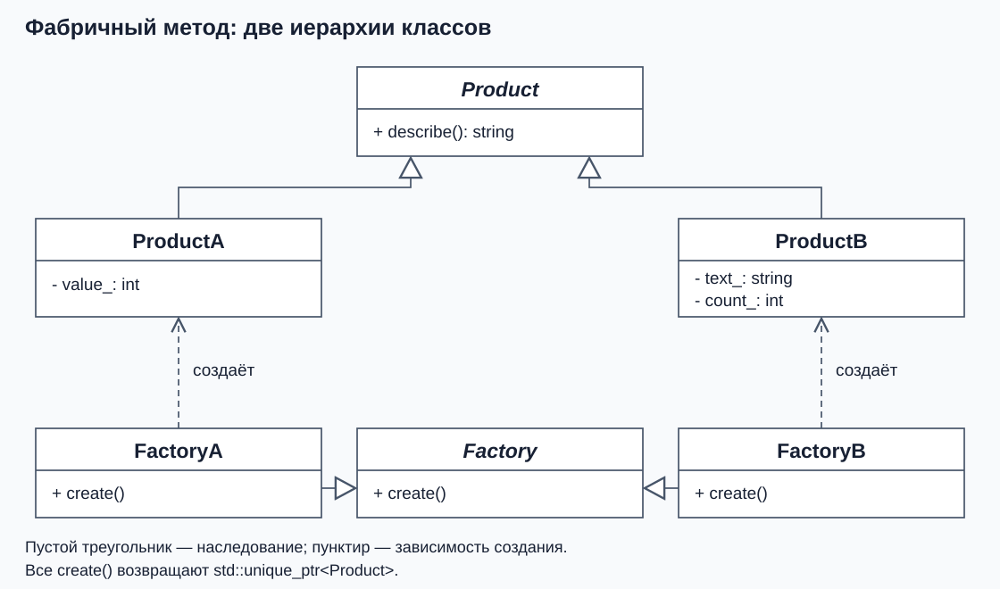

# Паттерны проектирования и фабричный метод

## Какие задачи повторяются при проектировании

Приложения решают разные бизнес-задачи, но в их устройстве часто возникают похожие вопросы. Кто выбирает конкретный класс объекта? Как добавить новую реализацию, сохранив общий использующий код? Как сообщить нескольким компонентам об изменении данных?

С такими задачами сталкивались многие разработчики. Удачные способы их решения можно описать, дать им названия и применять в других программах. Так появляются **паттерны проектирования**, или **шаблоны проектирования**.

Паттерн описывает повторяющуюся задачу, условия применения решения, роли его участников и связи между ними. Полезное описание также объясняет последствия: какие изменения станут проще и какие дополнительные классы или зависимости появятся. Конкретные имена, данные и реализация зависят от программы.

Например, фабричный метод описывает разделение между общим интерфейсом создания и конкретными создателями. В одной программе продуктом будет объект для обработки документа, в другой — клиент внешнего сервиса. Предметная область меняется, а способ организации создания можно использовать повторно.

Слово «шаблон» здесь относится к проектированию. В C++ также есть языковой механизм `template`; для реализации паттерна он может вообще не понадобиться.

## Зачем знать уже найденные решения

Каждый раз придумывая устройство программы с нуля, легко повторить уже известные трудности: размножить условия выбора по разным модулям, тесно связать общий код с конкретными классами или сделать добавление новой реализации слишком дорогим. До рабочего решения можно дойти самостоятельно, потратив время на те же промежуточные варианты и их исправление.

Знакомство с паттернами позволяет использовать накопленный опыт:

- **Быстрее выбрать отправную точку.** Для распространённой задачи уже есть варианты решения и описание условий, при которых они полезны. Остаётся сопоставить их с требованиями своей программы.
- **Заранее обсудить последствия.** Можно оценить, где останется выбор конкретного класса, что придётся менять при расширении и какие дополнительные объекты потребуются.
- **Понятнее общаться в команде.** Название «фабричный метод» обозначает знакомую структуру. Коллегам проще обсуждать её применение, читать код и проверять, соблюдены ли договорённости.

Поэтому для типичной проблемы полезно сначала изучить известные подходы. Это позволяет направить больше усилий на особенности своей задачи: данные, правила обработки, ошибки и требования к работе программы.

## Как применять паттерн осмысленно

Начинаем с конкретной проблемы и ожидаемых изменений. Затем выбираем подходящий способ организации кода и проверяем, оправдана ли его сложность. Например, непосредственного вызова конструктора может быть достаточно для одного известного класса. Если общий алгоритм должен работать с разными способами создания, появляется основание выделить фабрику.

Реализацию адаптируют к языку и проекту. В нашем C++-примере созданным объектом будет владеть `unique_ptr`. В другой реализации того же паттерна управление временем жизни может быть устроено иначе. Правильность кода и выполнение бизнес-требований всё равно нужно проверять.

О понятии паттерна и его пользе: [What's a design pattern?](https://refactoring.guru/design-patterns/what-is-pattern), [Why should I learn patterns?](https://refactoring.guru/design-patterns/why-learn-patterns).

## Первая задача: отделить создание от использования

Код может использовать объекты через общий интерфейс. При создании объекта нужно выбрать конкретный класс и передать аргументы его конструктору. Если эти решения повторяются в разных местах программы, изменение способа создания затронет каждое из них.

Теперь отделим создание от использования. **Фабрикой** будем называть объект, отвечающий за получение готового продукта. В наших примерах каждый вызов фабрики создаёт новый объект и передаёт владение вызывающему коду.

## Один интерфейс, разные конструкторы

Чтобы сосредоточиться на механизме, возьмём условные продукты. Они только хранят параметры и умеют описать себя. Для следующих классов нужны `<memory>`, `<string>` и `<utility>`.

```cpp
class Product {
public:
    virtual ~Product() = default;
    virtual std::string describe() const = 0;
};

class ProductA final : public Product {
public:
    explicit ProductA(int value) : value_(value) {}

    std::string describe() const override {
        return "ProductA(value=" + std::to_string(value_) + ")";
    }

private:
    int value_;
};

class ProductB final : public Product {
public:
    ProductB(std::string text, int count)
        : text_(std::move(text)), count_(count) {}

    std::string describe() const override {
        return "ProductB(text=" + text_ + ", count="
            + std::to_string(count_) + ")";
    }

private:
    std::string text_;
    int count_;
};
```

`std::to_string` превращает число в строку. В `ProductB` строка сначала поступает в параметр по значению, затем перемещается в поле. Эти детали определяют хранение состояния; интерфейс `describe()` у обоих продуктов одинаковый.

Непосредственное создание выглядит так:

```cpp
auto first = std::make_unique<ProductA>(10);
auto second = std::make_unique<ProductB>("demo", 2);
```

Оба вызова допустимы, но место их вызова знает конкретные классы и наборы аргументов. Если создание разбросано по программе, изменения в конструкторах затронут эти места. Фабрика позволяет собрать такую работу отдельно.

## Общий интерфейс создания

У всех фабрик будет одна операция:

```cpp
class Factory {
public:
    virtual ~Factory() = default;
    virtual std::unique_ptr<Product> create() const = 0;
};
```

`create()` — **фабричный метод**. Базовый класс задаёт интерфейс создания, а наследники выбирают конкретный продукт, переопределяя этот метод. Так устроен паттерн **Factory Method**.

Метод возвращает `std::unique_ptr<Product>`, поэтому вызывающий код получает владельца продукта. Виртуальный деструктор `Product` позволяет правильно удалить конкретный объект через базовый тип. У `Factory` тоже виртуальный деструктор: позднее реестр будет владеть конкретными фабриками через `std::unique_ptr<Factory>`.

Договор для всех фабрик в этом занятии:

- Успешный `create()` возвращает непустой `unique_ptr` на новый, готовый к использованию продукт и передаёт владение вызывающему коду.
- Если продукт создать нельзя, вызов бросает исключение. Возвращать `nullptr` для обозначения ошибки эти фабрики не должны.
- Ошибки конструктора и выделения памяти передаются вызывающему коду. Сам фабричный метод не превращает отказ в успешный результат.

Это договор нашего интерфейса: сам тип `unique_ptr` допускает пустое состояние. Поэтому автор новой фабрики должен соблюдать требование непустого результата. В клиенте можно сразу использовать продукт после успешного вызова.

## Конкретная фабрика знает свой конструктор

Каждая фабрика хранит настройки, необходимые своему продукту:

```cpp
class FactoryA final : public Factory {
public:
    explicit FactoryA(int value) : value_(value) {}

    std::unique_ptr<Product> create() const override {
        return std::make_unique<ProductA>(value_);
    }

private:
    int value_;
};

class FactoryB final : public Factory {
public:
    FactoryB(std::string text, int count)
        : text_(std::move(text)), count_(count) {}

    std::unique_ptr<Product> create() const override {
        return std::make_unique<ProductB>(text_, count_);
    }

private:
    std::string text_;
    int count_;
};
```

`FactoryA` создаёт `ProductA` с одним аргументом, `FactoryB` — `ProductB` с двумя. **Общий интерфейс фабрик не требует одинаковых конструкторов продуктов.** Каждая реализация `create()` сама знает нужную сигнатуру.



На этой схеме пустой треугольник направлен к базовому классу. Пунктирная стрелка с подписью «создаёт» связывает конкретную фабрику с продуктом. Между фабрикой и продуктом нет наследования.

## Передать готовый продукт или фабрику

Если функции нужен уже существующий объект, достаточно передать сам продукт через общий интерфейс. Для вывода нужен `<iostream>`:

```cpp
void useProduct(const Product& product) {
    std::cout << product.describe() << '\n';
}

ProductA product(10);
useProduct(product);
useProduct(product);
```

Оба вызова используют один объект. Функция не создаёт продукт и не управляет моментом его появления. Такой интерфейс подходит, когда готовый объект уже есть у вызывающего кода.

Фабрика нужна клиенту, который **сам определяет момент создания новых объектов**. Например, алгоритм выполняет несколько независимых операций и каждой нужен свой продукт. Передадим ему способ создания:

```cpp
class ProductClient {
public:
    explicit ProductClient(const Factory& factory) : factory_(factory) {}

    void run(int operations) const {
        for (int index = 0; index < operations; ++index) {
            auto product = factory_.create();
            std::cout << "operation " << index + 1 << ": ";
            useProduct(*product);
        }
    }

private:
    const Factory& factory_;
};

FactoryA factoryA(10);
FactoryB factoryB("demo", 2);
ProductClient clientA(factoryA);
ProductClient clientB(factoryB);
clientA.run(2);
clientB.run(2);
```

Вывод:

```text
operation 1: ProductA(value=10)
operation 2: ProductA(value=10)
operation 1: ProductB(text=demo, count=2)
operation 2: ProductB(text=demo, count=2)
```

В терминах паттерна **клиент** — код, использующий фабрику и продукт. Здесь это `ProductClient`, а не человек, пользующийся приложением.

Сначала виртуальный вызов `create()` выбирает реализацию конкретной фабрики. Затем виртуальный вызов `describe()` выбирает реализацию созданного продукта. Метод `ProductClient::run` не перечисляет классы продуктов и не знает аргументов их конструкторов.

Фабрика передаётся клиенту через конструктор. Поле `factory_` — невладеющая ссылка, поэтому фабрика должна жить дольше клиента. В примере фабрики объявлены раньше клиентов и уничтожатся после них. В каждой итерации `run(operations)` создаётся новый продукт; локальный `unique_ptr` удаляет его в конце итерации. Параметр `operations` определяет число операций, поэтому клиенту не нужно заранее передавать набор готовых объектов.

Выбор конкретной фабрики всё равно происходит в программе: здесь это объявления `factoryA` и `factoryB`. Паттерн переносит знание о создании в подходящее место, но не устраняет необходимость сделать выбор.

## Повторный вызов и владение

У `create()` стоит `const`, потому что в нашем примере создание продукта не меняет настройки фабрики. `FactoryB::create()` передаёт `text_` в конструктор продукта копированием, поэтому строка остаётся доступна для следующих вызовов. Перемещение строки в поле самого `ProductB` выполняется уже из его собственного параметра.

Повторные вызовы создают независимые объекты с одинаковыми начальными параметрами. Уничтожение фабрики не удаляет уже выданные продукты: строка и числа хранятся в самих продуктах, которыми владеет клиент.

Для нового `ProductC` потребуется определить продукт, его фабрику и подключить эту фабрику в месте настройки программы. Код `ProductClient` сохранится. Цена такого расширения — отдельный класс фабрики для каждого варианта создания.

## В каких сценариях это удобно

**Общий случай:** один и тот же клиентский алгоритм должен работать с разными реализациями продукта и сам создавать их по мере необходимости. При этом конкретный класс, аргументы конструктора и подготовка объекта зависят от выбранной реализации. Эти знания можно передать клиенту в виде отдельного объекта-фабрики с общим интерфейсом.

Признаки подходящей задачи:

- Клиенту важно поведение продукта через общий интерфейс; знание о конкретных классах не относится к его задаче.
- Создание тоже должно быть заменяемым: другой модуль или настройка приложения может предоставить свою реализацию фабрики.
- Для добавления нового способа создания допустимо написать новый класс фабрики и подключить его при настройке программы.

**Как пользоваться:** код настройки создаёт конкретную фабрику и передаёт её клиенту через `Factory&`. Клиент вызывает `create()` тогда, когда ему нужен продукт. В показанном варианте клиент хранит выбранную фабрику, поэтому при очередной операции ему не нужно снова выбирать тип продукта.

**Пример:** сервис может использовать клиент реальной внешней системы или локальную тестовую реализацию. Фабрика рабочего варианта знает адрес и настройки подключения, тестовая — способ создания объекта с подготовленными ответами. Код, выполняющий операцию через общий интерфейс, получает подходящую фабрику при настройке. Это частный случай подмены создания при сохранении использующего алгоритма.

**Цена решения:** появляется иерархия фабрик и место их подключения. Такой вариант оправдан, когда клиенту действительно нужна подмена способа создания. Если весь выбор удобно описать одним небольшим условием и отдельные создатели не нужны, можно использовать одну параметризованную фабрику.

**Проверьте себя:** что мы переиспользуем, применяя паттерн? Когда достаточно передать `Product&`, а когда нужен `Factory&`? Почему у продуктов могут быть разные конструкторы? Что обещает успешный `create()` и как сообщает об отказе?

**Ответ:** переиспользуем способ организации решения с его ролями и связями. Готовый продукт передают для использования существующего объекта; фабрику — для создания новых объектов по мере необходимости. Аргументы конструктора знает конкретная фабрика. Успех означает непустой владеющий указатель на новый продукт, отказ передаётся исключением.

Описание паттерна: [Factory Method](https://refactoring.guru/design-patterns/factory-method).

Далее: [одна фабрика с выбором типа](02-parameterized-factory.md).
