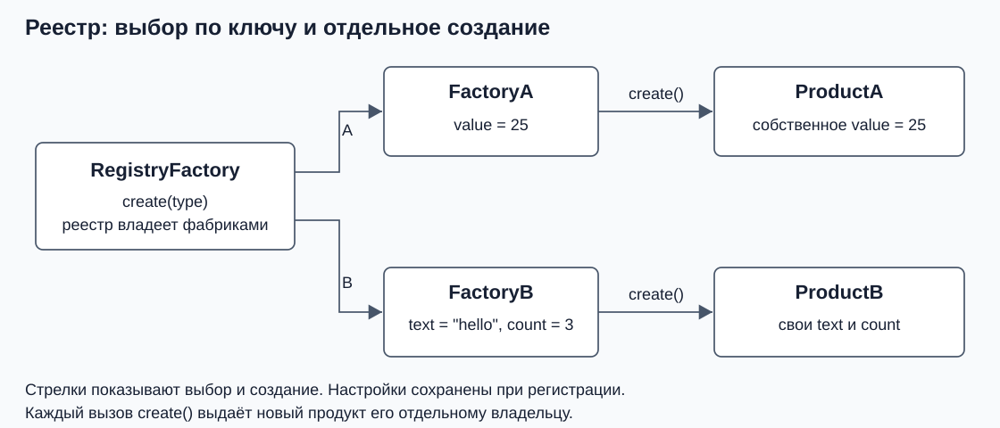

# Реестр настроенных фабрик

Объединим два предыдущих варианта. Клиент будет выбирать продукт по `ProductType`, а знание о его конструкторе останется в конкретной фабрике. Сохраняются продукты, `Factory`, `FactoryA` и `FactoryB` из первой части и перечисление из второй.

Это гибрид: **реестр выбирает фабрику по ключу, а выбранная фабрика создаёт продукт**. В примере используются виртуальные методы и `unique_ptr`.

## Что хранится в реестре

Нужно запомнить два соответствия: метке A отвечает настроенная `FactoryA`, метке B — настроенная `FactoryB`. Для такого хранения используем стандартный контейнер `std::map` из `<map>`:

```cpp
std::map<ProductType, std::unique_ptr<Factory>> factories_;
```

Первый тип в угловых скобках — тип ключа. Второй — тип значения. В нашем контейнере одному ключу соответствует один владелец фабрики. Благодаря базовому `Factory` контейнер может владеть разными конкретными фабриками.

Это готовый шаблон стандартной библиотеки. Для занятия нужны только добавление значения по ключу и поиск; писать собственный контейнер не требуется.

## Регистрация и создание

Для следующего класса нужны `<map>`, `<memory>`, `<stdexcept>` и `<utility>`:

```cpp
class RegistryFactory {
public:
    void add(ProductType type, std::unique_ptr<Factory> factory) {
        if (!factory) {
            throw std::invalid_argument("Factory must not be null");
        }

        factories_.insert_or_assign(type, std::move(factory));
    }

    std::unique_ptr<Product> create(ProductType type) const {
        const auto found = factories_.find(type);

        if (found == factories_.end()) {
            throw std::invalid_argument("Product type is not registered");
        }

        return found->second->create();
    }

private:
    std::map<ProductType, std::unique_ptr<Factory>> factories_;
};
```

`add()` принимает владельца фабрики по значению. Затем `std::move(factory)` передаёт владение в контейнер. Копировать `unique_ptr` нельзя. Пустую фабрику запрещаем при регистрации, чтобы успешный поиск всегда позволял вызвать `create()`.

`insert_or_assign` добавляет запись, а если ключ уже существует — заменяет её значение. В нашем примере повторная регистрация означает замену настроенной фабрики. Старый объект фабрики при этом удаляется; уже выданные продукты остаются у своих владельцев.

`find()` ищет запись по ключу и возвращает **итератор** — объект для доступа к элементу контейнера. `auto` позволяет компилятору вывести его тип. Если записи нет, результат равен `end()`. Поэтому сначала проверяем поиск и только затем обращаемся к записи.

У найденной записи `first` — ключ, `second` — значение. Здесь `found->second` обозначает `unique_ptr<Factory>`, а следующий `->create()` вызывает виртуальный метод выбранной фабрики. Поиск не создаёт новую запись.

## Разные настройки за одинаковым create

Настроим реестр:

```cpp
RegistryFactory factory;
factory.add(ProductType::A, std::make_unique<FactoryA>(25));
factory.add(ProductType::B, std::make_unique<FactoryB>("hello", 3));

auto first = factory.create(ProductType::A);
auto second = factory.create(ProductType::B);
std::cout << first->describe() << '\n';
std::cout << second->describe() << '\n';
```

Для вывода нужен `<iostream>`. Получим:

```text
ProductA(value=25)
ProductB(text=hello, count=3)
```



На этой схеме стрелки показывают выбор и создание. Наследование показано отдельно в первой части.

Здесь есть два момента времени. **При регистрации** программа выбирает фабрику и задаёт её настройки. **При создании продукта** клиент передаёт только метку, а фабрика использует уже сохранённые параметры. У `RegistryFactory::create()` нет знания о `value`, `text` или `count`.

В этом интерфейсе параметры не передаются заново с каждым вызовом `create(type)`. Замена регистрации меняет настройки для последующих продуктов. Если данные меняются для каждой отдельной операции, их следует передавать в метод создания; такой вариант разобран ниже.

Настройку реестра обычно выполняют при запуске приложения. Затем код обработки запросов получает готовый реестр и выбирает продукт по метке для текущей операции. Ему не нужно заново создавать фабрики или повторять их регистрацию для каждого запроса.

## Фабрика и продукты живут отдельно

Создадим ещё один продукт A рядом с уже созданным `first`:

```cpp
auto another = factory.create(ProductType::A);
std::cout << "same product: "
          << (first.get() == another.get() ? "yes" : "no") << '\n';
```

Вывод — `same product: no`. Оба объекта живы одновременно и имеют разных владельцев. Реестр хранит фабрики, а продукты появляются в результате вызовов этих фабрик. В нашем `create()` каждый раз выполняется `make_unique`.

После замены регистрации новые продукты получат новые настройки:

```cpp
factory.add(ProductType::A, std::make_unique<FactoryA>(99));
auto updated = factory.create(ProductType::A);
std::cout << first->describe() << '\n';   // ProductA(value=25)
std::cout << updated->describe() << '\n'; // ProductA(value=99)
```

Первый продукт уже хранит собственное значение, поэтому замена фабрики его не меняет. При уничтожении реестра удаляются оставшиеся в нём фабрики. Выданные продукты уничтожаются своими `unique_ptr` независимо от этого.

## Настройки фабрики и параметры операции

Разделим два вида данных. **Настройки фабрики** действуют для многих созданий; **параметры операции** относятся к одному вызову. Например, фабрика A может хранить допустимый предел, а значение нового продукта получать при каждом обращении.

Это отдельный вариант интерфейса для продукта A. Его `create(int)` принимает данные операции; он не переопределяет безаргументный `Factory::create()`:

```cpp
class OperationFactoryA {
public:
    explicit OperationFactoryA(int limit) : limit_(limit) {
        if (limit < 0) {
            throw std::invalid_argument("Factory limit must be non-negative");
        }
    }

    std::unique_ptr<Product> create(int value) const {
        if (value < 0 || value > limit_) {
            throw std::invalid_argument("Value is outside the factory limit");
        }
        return std::make_unique<ProductA>(value);
    }

private:
    int limit_;
};
```

Нужны `<memory>` и `<stdexcept>`. Зададим предел один раз и создадим два продукта с разными значениями:

```cpp
OperationFactoryA factory(100);
auto first = factory.create(10);
auto second = factory.create(20);
useProduct(*first);
useProduct(*second);
```

Вывод:

```text
ProductA(value=10)
ProductA(value=20)
```

Поле `limit_` остаётся равным `100`, а аргумент `value` меняется от вызова к вызову. `create(101)` бросит `std::invalid_argument` до создания продукта. Возвращать пустой указатель для этого отказа не требуется: действует договор об исключениях.

Для нескольких видов продуктов интерфейс передачи данных выбирают по смыслу задачи. Если у операций есть общие данные, их можно передавать общему методу создания. Если наборы данных различаются, полезны отдельные типизированные методы или отдельные создатели, понимающие свой запрос. Разница конструкторов сама по себе не задаёт универсальную сигнатуру `create()`.

## Что потребуется для расширения

Для `ProductC` добавим сам класс, соответствующую `FactoryC`, новое значение `ProductType` и регистрацию настроенной фабрики. Код `RegistryFactory::create()` останется прежним: он уже умеет искать любую запись и вызывать общий интерфейс.

Выбор и подключение реализаций находятся в месте регистрации. Вариант со `switch` хранит этот выбор внутри одной фабрики; вариант с реестром хранит его в наборе записей и конкретных создателях. Реестр добавляет контейнер и этап настройки, поэтому он полезен, когда такое разделение нужно программе.

## В каких сценариях это удобно

**Общий случай:** продукт нужно выбирать по ключу при каждом обращении, а способы создания должны подключаться и настраиваться отдельно от кода выбора. Каждая конкретная фабрика знает свой продукт и его параметры. Общий реестр хранит соответствие «ключ — настроенная фабрика» и делегирует ей создание через единый интерфейс.

Признаки подходящей задачи:

- Клиент выбирает продукт по метке, но общему диспетчеру не требуется знать конкретные классы и их конструкторы.
- Создатели имеют собственные настройки или предоставляются разными модулями; их удобно готовить и подключать отдельно.
- Новый способ создания нужно добавлять через конкретную фабрику и регистрацию, сохраняя алгоритм поиска и делегирования.

**Как пользоваться:** при настройке приложения код создаёт конкретные фабрики с необходимыми параметрами и вызывает `add(...)`. При обработке каждой операции клиент передаёт ключ в `create(type)` и получает новый продукт. В нашем варианте настройки сохраняются при регистрации; новые параметры конструктора при каждом обращении не передаются.

**Пример:** в системе обработки документов один обработчик таблиц требует разделитель и кодировку, другой обработчик сканов — язык и путь к модели. При запуске регистрируются фабрики с этими настройками. По виду поступившего документа диспетчер выбирает фабрику и получает готовый обработчик. Здесь разные конструкторы и настройки скрыты за создателями, а выбор по ключу остаётся общим.

**Цена решения:** нужно хранить фабрики и обеспечить регистрацию всех нужных ключей до обработки обращений. Само различие конструкторов ещё не требует реестра: разные вызовы можно записать и в ветвях `switch`. Реестр полезен именно тогда, когда способы создания и их настройку нужно отделить от общего выбора. Учебный ключ `ProductType` задан перечислением, поэтому новый тип также потребует изменения перечисления и пересборки программы.

**Проверьте себя:** что хранит реестр — продукты или фабрики? Чем отличаются настройки фабрики от параметров операции? Что произойдёт при отсутствии регистрации или при `OperationFactoryA(100).create(101)`? Поменяется ли уже выданный продукт после замены его фабрики?

**Ответ:** реестр владеет фабриками. Постоянные настройки хранятся в фабрике, параметры операции передаются для конкретного создания. В обоих ошибочных случаях выбрасывается `std::invalid_argument`. Уже выданный продукт имеет собственное состояние и остаётся прежним.

Операции контейнера: [Modifiers](https://eel.is/c++draft/map.modifiers) (`insert_or_assign`) и [Map](https://eel.is/c++draft/map) в рабочем проекте стандарта C++.

Далее: [демонстрационный проект](../practice/README.md).
